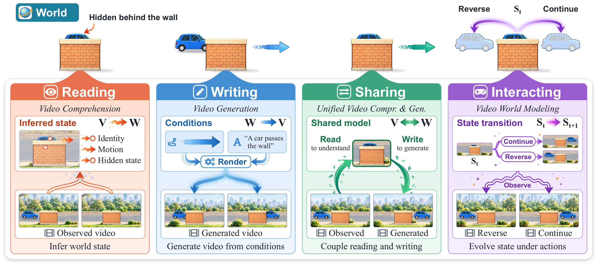
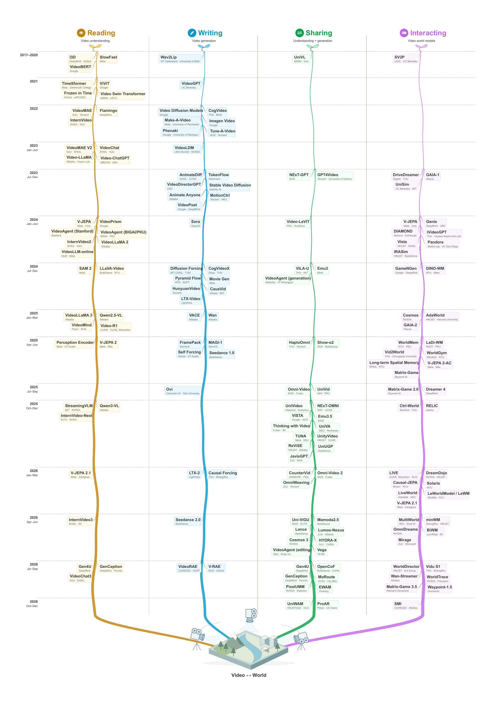

  <h1>Revisiting Video Foundation Models through the Lens of World Modeling</h1>

  
 <strong>Reading</strong> &nbsp;  <strong>Writing</strong> &nbsp;  <strong>Sharing</strong> &nbsp;  <strong>Interacting</strong> with the World through Video

  
<strong>A survey and open reference collection</strong>

  
  
  
  

  
Shengqiong Wu1,* · Meng Luo2,* · Bobo Li1 · Ziwei Liu3 Shuicheng Yan2 · Ming-Hsuan Yang4 · Philip Torr1 · Hao Fei1,†

  
1 University of Oxford &nbsp;·&nbsp; 2 National University of Singapore 3 Nanyang Technological University &nbsp;·&nbsp; 4 University of California, Merced * Equal contribution &nbsp;·&nbsp; † Project lead & correspondence

## Awesome Video World Models

**[Project website](https://vid-gen.github.io/video-world-model-survey/) · [Search the literature](https://vid-gen.github.io/video-world-model-survey/#library) · [Download BibTeX](references.bib) · [Suggest a paper](https://github.com/vid-gen/awesome-video-world-model/issues/new?template=new-paper.yml)**

Video records only part of a changing world. Our survey, **Revisiting Video Foundation Models through the Lens of World Modeling**, connects video comprehension, generation, unified modeling, and video world models through four operations: **reading, writing, sharing, and interacting**.

This repository brings together the survey's core framework and **652 references**. The complete literature list is directly readable below; the website adds a guided overview, filtering, and BibTeX export. Each work appears once in its primary research area, newest first within each area.

**Updated:** October 14, 2026.

## Contents

[Browse the literature](#browse-the-literature) · [The survey at a glance](#the-survey-at-a-glance) · [Research timeline](#research-timeline) · [World-model taxonomy](#world-model-taxonomy) · [Evidence and open questions](#evidence-and-open-questions) · [Literature](#literature) · [Publication](#publication) · [Contributing](#contributing)

## Browse the literature

Select a research area to jump straight to its papers. All entries are readable here on GitHub.

  
  
  
   
  
  
  

## The survey at a glance

An **observed video** is a partial, lossy, temporally ordered trace of a **latent temporal world**. A model maintains its own **represented state**, which can be incomplete or wrong. The four operations describe different ways of connecting these objects; one system can perform several operations.

| Operation | Core question | The survey covers | References |
| :--- | :--- | :--- | ---: |
|  **[Reading](#reading)** · video comprehension | What world properties can be inferred from the trace? | Tasks and benchmarks; representation learning; Video-LLMs; video agents; applications | 151 |
|  **[Writing](#writing)** · video generation | What trace follows from a partial world specification? | Tasks and conditions; latent representations; generative models; control; applications | 122 |
|  **[Sharing](#sharing)** · unified video models | How can comprehension and generation support one another? | Unified architectures; learning paradigms; editing and reasoning; cross-direction evaluation | 60 |
|  **[Interacting](#interacting)** · video world models | How does state evolve under actions and new observations? | Architectures and training; control and memory; responsiveness and grounding; applications and evaluation | 114 |

**Supporting collections:** [Datasets, Benchmarks and Evaluation](#evaluation) (184) · [Surveys and Foundations](#foundations) (21).

> **Temporal coherence and world consistency are different.** Smooth neighboring frames do not establish persistent identity, layout, physics, or causal responses. A hard cut can break visual smoothness while preserving the world. Neither property implies the other.

## Research timeline

The paper's original timeline traces selected milestones in the four research directions from 2017 to 2026. [View the timeline on the project website →](https://vid-gen.github.io/video-world-model-survey/#timeline)

<strong>Expand the original research timeline</strong>

The website also presents the paper's original representation-learning, generation, unification, world-model taxonomy, and challenge figures. [Explore the visual survey →](https://vid-gen.github.io/video-world-model-survey/#reading)

## World-model taxonomy

The survey crosses **prediction space** with **transition interface**. The same model can occupy different cells depending on how it is trained and used.

| Prediction space | Passive: no action input | Action-conditioned: fixed controls | Interactive: new controls after feedback |
| :--- | :--- | :--- | :--- |
| **Observation space** — frames, video tokens, or video-decoding latents | Forecast video from observed history | Predict controlled video from a supplied action sequence | Advance a visual world after each new control |
| **Latent state** — video-derived features without required rendering | Predict target features from context | Roll out candidate feature trajectories | Plan, act, observe, and replan |

Predicting generative latents that are decoded into video still counts as observation-space prediction. “Interactive” describes the control interface, not the attention pattern. [Explore the taxonomy →](https://vid-gen.github.io/video-world-model-survey/#world-models)

## Evidence and open questions

Stronger claims require stronger evidence: **plausible output → faithfulness to evidence or conditions → consistent state and controlled cross-direction transfer → decision utility**. For unified models, capability coverage, shared machinery, and functional synergy are distinct claims.

The survey identifies seven connected research problems:

1. **Long-horizon world consistency:** maintain evolving hidden state, not only stored observations.
2. **Physical and causal grounding:** respond correctly to interventions while preserving unrelated state.
3. **Measurable synergy:** isolate the contribution of sharing under matched resources.
4. **Standardized evaluation:** compare world properties under explicit, compatible protocols.
5. **Control from unlabeled video:** connect observed motion to usable action semantics.
6. **Scene and embodiment generalization:** test what survives changes in environment, camera, and body.
7. **Stochastic worlds and rare events:** measure calibrated outcomes, not only sample diversity.

[Read the overview and proposed tests →](https://vid-gen.github.io/video-world-model-survey/#questions)

## Literature

Entries follow **title · [paper] · [code] · [project] · venue**; additional **[data]** links point to released datasets. Resource links are checked against the paper and author- or institution-maintained sources. Version-specific directories, branches, or snapshots are used for shared repositories; an unreleased implementation is not labeled as code. Reports and books use **[source]** and **[book]** where appropriate. Full author lists and citations are available in [BibTeX](references.bib).

    

Jump directly to **[Reading](#reading)** · **[Writing](#writing)** · **[Sharing](#sharing)** · **[Interacting](#interacting)** · **[Evaluation](#evaluation)** · **[Foundations](#foundations)**.

Years and venues follow the cited bibliographic records; some records use a preprint year. Categories reflect a work's primary placement and do not imply that its capabilities are restricted to that operation.

## Reading the World

Video comprehension, representation learning, Video-LLMs, long-video reasoning, streaming perception, and video agents. **151 references.**

**Years:** [2026](#reading-2026) · [2025](#reading-2025) · [2024](#reading-2024) · [2023](#reading-2023) · [2022](#reading-2022) · [2021](#reading-2021) · [2020](#reading-2020) · [2019](#reading-2019) · [2017](#reading-2017).

### 2026

- A Multi-Agent Perception-Action Alliance for Efficient Long Video Reasoning. [[paper](<https://arxiv.org/abs/2603.14052>)] [[code](<https://github.com/git-disl/A4VL>)] 
- Accuracy and Cost Claims Do Not Survive Re-Execution in Agentic VideoQA. [[paper](<https://arxiv.org/abs/2607.01469>)] 
- APT: Atomic Physical Transitions for Causal Video-Language Understanding. [[paper](<https://arxiv.org/abs/2606.18586>)] [[project](<https://polite-bombolone-d4250c.netlify.app/>)] 
- Audio-Visual Intelligence in Large Foundation Models. [[paper](<https://arxiv.org/abs/2605.04045>)] [[project](<https://github.com/JavisVerse/Awesome-AVI>)] 
- CASE: Cost-Aware Stopping for Efficient Long-Video Agents. [[paper](<https://arxiv.org/abs/2610.05400>)] 
- Efficient Universal Perception Encoder. [[paper](<https://arxiv.org/abs/2603.22387>)] [[code](<https://github.com/facebookresearch/EUPE>)] 
- EgoTools: Towards Tool-Centric Reasoning in Real-World Egocentric Videos. [[paper](<https://arxiv.org/abs/2609.39378>)] [[code](<https://github.com/Ropedia/EgoTools>)] [[project](<https://ropedia.github.io/egotools/>)] 
- EVA: Efficient Reinforcement Learning for End-to-End Video Agent. [[paper](<https://arxiv.org/abs/2603.22918>)] [[code](<https://github.com/wangruohui/EfficientVideoAgent>)] [[project](<https://mercury7353.github.io/EVA-Page/>)] 
- From Verbatim to Gist: Distilling Pyramidal Multimodal Memory via Semantic Information Bottleneck for Long-Horizon Video Agents. [[paper](<https://arxiv.org/abs/2603.01455>)] [[code](<https://github.com/EliSpectre/MM-Mem>)] 
- InternVideo3: Agentify Foundation Models with Multimodal Contextual Reasoning. [[paper](<https://arxiv.org/abs/2606.12195>)] [[code](<https://github.com/OpenGVLab/InternVideo/tree/main/InternVideo3> "InternVideo3 directory for arXiv:2606.12195.")] 
- LLaVA-OneVision-2: Towards Next-Generation Perceptual Intelligence. [[paper](<https://arxiv.org/abs/2605.25979>)] [[code](<https://github.com/EvolvingLMMs-Lab/LLaVA-OneVision-2>)] [[project](<https://evolvinglmms-lab.github.io/LLaVA-OneVision-2/>)] 
- LongVT: Incentivizing “Thinking with Long Videos” via Native Tool Calling. [[paper](<https://arxiv.org/abs/2511.20785>)] [[code](<https://github.com/EvolvingLMMs-Lab/LongVT>)] [[project](<https://evolvinglmms-lab.github.io/LongVT/>)] 
- OneStreamer: Unifying Perception, Memory, and Proactive Response in Streaming Video Interaction. [[paper](<https://arxiv.org/abs/2610.01762>)] [[project](<https://mcg-nju.github.io/OneStreamer/>)] 
- OneThinker: All-in-one Reasoning Model for Image and Video. [[paper](<https://arxiv.org/abs/2512.03043>)] [[code](<https://github.com/tulerfeng/OneThinker>)] 
- SCP: Spatial Causal Prediction in Video. [[paper](<https://arxiv.org/abs/2603.03944>)] [[project](<https://guangstrip.github.io/SCP-Bench/>)] 
- Think, Then Verify: A Hypothesis-Verification Multi-Agent Framework for Long Video Understanding. [[paper](<https://arxiv.org/abs/2603.04977>)] [[code](<https://github.com/Haorane/VideoHV-Agent>)] [[project](<https://haorane.github.io/VideoHV-Agent/>)] 
- V-JEPA 2.1: Unlocking Dense Features in Video Self-Supervised Learning. [[paper](<https://arxiv.org/abs/2603.14482>)] [[code](<https://github.com/facebookresearch/vjepa2#v-jepa-21-pre-training> "V-JEPA 2.1 pre-training section in the shared V-JEPA repository.")] 
- Video Generation Models are General-Purpose Vision Learners. [[paper](<https://arxiv.org/abs/2607.09024>)] [[code](<https://github.com/google-deepmind/representations4d>)] [[project](<https://genception.github.io>)] 
- Video Reasoning without Training. [[paper](<https://arxiv.org/abs/2510.17045>)] [[project](<https://deepaksridhar.github.io/vreason.github.io/>)] 
- VideoChat-A1: Thinking with Long Videos by Chain-of-Shot Reasoning. [[paper](<https://arxiv.org/abs/2506.06097>)] [[code](<https://github.com/SpXace/VideoChat-A1>)] 
- VideoChat3: Fully Open Video MLLM for Efficient and Generalist Video Understanding. [[paper](<https://arxiv.org/abs/2607.14935>)] [[code](<https://github.com/MCG-NJU/VideoChat3>)] 
- VideoThinker: Building Agentic VideoLLMs with LLM-Guided Tool Reasoning. [[paper](<https://arxiv.org/abs/2601.15724>)] 
- VisPhyWorld: Probing Physical Reasoning via Code-Driven Video Reconstruction. [[paper](<https://arxiv.org/abs/2602.13294>)] [[code](<https://github.com/TIGER-AI-Lab/VisPhyWorld>)] [[project](<https://tiger-ai-lab.github.io/VisPhyWorld/>)] 

### 2025

- Apollo: An Exploration of Video Understanding in Large Multimodal Models. [[paper](<https://openaccess.thecvf.com/content/CVPR2025/html/Zohar_Apollo__An_Exploration_of_Video_Understanding_in_Large_Multimodal_CVPR_2025_paper.html>)] [[project](<https://apollo-lmms.github.io>)] 
- AViLA: Asynchronous Vision-Language Agent for Streaming Multimodal Data Interaction. [[paper](<https://arxiv.org/abs/2506.18472>)] [[project](<https://tanveer81.github.io/publication/avila/>)] 
- Deep Video Discovery: Agentic Search with Tool Use for Long-form Video Understanding. [[paper](<https://arxiv.org/abs/2505.18079>)] [[code](<https://github.com/microsoft/DeepVideoDiscovery>)] 
- DeepSeek-R1 incentivizes reasoning in LLMs through reinforcement learning. [[paper](<https://doi.org/10.1038/s41586-025-09422-z>)] [[code](<https://github.com/deepseek-ai/DeepSeek-V3/tree/main/inference> "R1 authors explicitly refer to the shared DeepSeek-V3 inference implementation; R1 checkpoints and documentation remain in the R1 project repository.")] [[project](<https://github.com/deepseek-ai/DeepSeek-R1> "First-generation DeepSeek-R1/R1-Zero and their distilled releases; not a third-party implementation.")] 
- DeepVideo-R1: Video Reinforcement Fine-Tuning via Difficulty-aware Regressive GRPO. [[paper](<https://arxiv.org/abs/2506.07464>)] [[code](<https://github.com/mlvlab/DeepVideoR1>)] 
- Eagle 2.5: Boosting Long-Context Post-Training for Frontier Vision-Language Models. [[paper](<https://arxiv.org/abs/2504.15271>)] [[code](<https://github.com/NVlabs/EAGLE>)] [[project](<https://nvlabs.github.io/Eagle/>)] 
- Ego-Exo4D: Understanding Skilled Human Activity from First- and Third-Person Perspectives. [[paper](<https://doi.org/10.1007/s11263-025-02557-6>)] [[project](<https://ego-exo4d-data.org/>)] 
- Ego-R1: Chain-of-Tool-Thought for Ultra-Long Egocentric Video Reasoning. [[paper](<https://arxiv.org/abs/2506.13654>)] [[project](<https://egolife-ai.github.io/Ego-R1/>)] 
- EgoLife: Towards Egocentric Life Assistant. [[paper](<https://arxiv.org/abs/2503.03803>)] [[code](<https://github.com/EvolvingLMMs-Lab/EgoLife>)] [[project](<https://egolife-ai.github.io/>)] 
- FineVision: Open Data Is All You Need. [[paper](<https://arxiv.org/abs/2510.17269>)] 
- FrameThinker: Learning to Think with Long Videos via Multi-Turn Frame Spotlighting. [[paper](<https://arxiv.org/abs/2509.24304>)] [[code](<https://github.com/lcqysl/FrameThinker>)] 
- GRPO-CARE: Consistency-Aware Reinforcement Learning for Multimodal Reasoning. [[paper](<https://arxiv.org/abs/2506.16141>)] [[code](<https://github.com/TencentARC/GRPO-CARE>)] 
- InternVideo-Next: Towards General Video Foundation Models without Video-Text Supervision. [[paper](<https://arxiv.org/abs/2512.01342>)] [[code](<https://github.com/OpenGVLab/InternVideo/tree/main/InternVideo-Next> "InternVideo-Next directory for arXiv:2512.01342.")] 
- InternVL3.5: Advancing Open-Source Multimodal Models in Versatility, Reasoning, and Efficiency. [[paper](<https://arxiv.org/abs/2508.18265>)] [[code](<https://github.com/OpenGVLab/InternVL>)] [[project](<https://internvl.github.io/blog/>)] 
- Kwai Keye-VL 1.5 Technical Report. [[paper](<https://arxiv.org/abs/2509.01563>)] [[code](<https://github.com/Kwai-Keye/Keye>)] 
- LongVideoAgent: Multi-Agent Reasoning with Long Videos. [[paper](<https://arxiv.org/abs/2512.20618>)] [[code](<https://github.com/longvideoagent/LongVideoAgent>)] [[project](<https://longvideoagent.github.io/>)] 
- LongVILA: Scaling Long-Context Visual Language Models for Long Videos. [[paper](<https://arxiv.org/abs/2408.10188>)] [[code](<https://github.com/NVlabs/VILA/tree/main/longvila>)] 
- MMVU: Measuring Expert-Level Multi-Discipline Video Understanding. [[paper](<https://doi.org/10.1109/cvpr52734.2025.00793>)] [[code](<https://github.com/yale-nlp/MMVU>)] [[project](<https://mmvu-benchmark.github.io>)] 
- Perception Encoder: The best visual embeddings are not at the output of the network. [[paper](<https://arxiv.org/abs/2504.13181>)] [[code](<https://github.com/facebookresearch/perception_models>)] [[project](<https://ai.meta.com/research/publications/perception-encoder-the-best-visual-embeddings-are-not-at-the-output-of-the-network/>)] 
- Qwen2.5-Omni Technical Report. [[paper](<https://arxiv.org/abs/2503.20215>)] [[code](<https://github.com/QwenLM/Qwen2.5-Omni>)] 
- Qwen2.5-VL Technical Report. [[paper](<https://arxiv.org/abs/2502.13923>)] [[code](<https://github.com/QwenLM/Qwen3-VL>)] 
- Qwen3-omni technical report. [[paper](<https://arxiv.org/abs/2509.17765>)] [[code](<https://github.com/QwenLM/Qwen3-Omni>)] 
- Qwen3-VL Technical Report. [[paper](<https://arxiv.org/abs/2511.21631>)] [[code](<https://github.com/QwenLM/Qwen3-VL>)] 
- SAGE: Training Smart Any-Horizon Agents for Long Video Reasoning with Reinforcement Learning. [[paper](<https://arxiv.org/abs/2512.13874>)] [[code](<https://github.com/allenai/SAGE>)] [[project](<https://praeclarumjj3.github.io/sage/>)] 
- Scaling RL to Long Videos. [[paper](<https://arxiv.org/abs/2507.07966>)] [[code](<https://github.com/NVlabs/Long-RL>)] 
- SceneRAG: Scene-level Retrieval-Augmented Generation for Video Understanding. [[paper](<https://arxiv.org/abs/2506.07600>)] 
- Seeing, Listening, Remembering, and Reasoning: A Multimodal Agent with Long-Term Memory. [[paper](<https://arxiv.org/abs/2508.09736>)] [[code](<https://github.com/bytedance-seed/m3-agent>)] [[project](<https://m3-agent.github.io>)] 
- SigLIP 2: Multilingual Vision-Language Encoders with Improved Semantic Understanding, Localization, and Dense Features. [[paper](<https://arxiv.org/abs/2502.14786>)] [[code](<https://github.com/google-research/big_vision/blob/main/big_vision/configs/proj/image_text/README_siglip2.md>)] 
- StreamAgent: Towards Anticipatory Agents for Streaming Video Understanding. [[paper](<https://arxiv.org/abs/2508.01875>)] 
- Streaming Video Instruction Tuning. [[paper](<https://arxiv.org/abs/2512.21334>)] [[code](<https://github.com/maifoundations/Streamo>)] [[project](<https://jiaerxia.github.io/Streamo/>)] 
- StreamingVLM: Real-Time Understanding for Infinite Video Streams. [[paper](<https://arxiv.org/abs/2510.09608>)] [[code](<https://github.com/mit-han-lab/streaming-vlm>)] 
- SurgVLM: A Large Vision-Language Model and Systematic Evaluation Benchmark for Surgical Intelligence. [[paper](<https://arxiv.org/abs/2506.02555>)] [[code](<https://github.com/jinlab-imvr/SurgVLM>)] [[project](<https://jinlab-imvr.github.io/SurgVLM/>)] 
- Thinking in Space: How Multimodal Large Language Models See, Remember, and Recall Spaces. [[paper](<https://doi.org/10.1109/cvpr52734.2025.00994>)] [[code](<https://github.com/vision-x-nyu/thinking-in-space>)] [[project](<https://vision-x-nyu.github.io/thinking-in-space.github.io/>)] 
- Time-R1: Post-Training Large Vision Language Model for Temporal Video Grounding. [[paper](<https://arxiv.org/abs/2503.13377>)] [[code](<https://github.com/xiaomi-research/time-r1>)] [[project](<https://xuboshen.github.io/Time-R1/>)] 
- TRAVL: A Recipe for Making Video-Language Models Better Judges of Physics Implausibility. [[paper](<https://arxiv.org/abs/2510.07550>)] [[project](<https://insait-institute.github.io/travl.github.io/>)] 
- Two Causally Related Needles in a Video Haystack. [[paper](<https://arxiv.org/abs/2505.19853>)] [[code](<https://github.com/jdsannchao/Causal2Needles>)] [[project](<https://limiaoyu.github.io/Causal2Needles/>)] 
- Unleashing Hour-Scale Video Training for Long Video-Language Understanding. [[paper](<https://arxiv.org/abs/2506.05332>)] [[code](<https://github.com/jylins/hourllava>)] [[project](<https://videomarathon.github.io/>)] 
- Video-Holmes: Can MLLM Think Like Holmes for Complex Video Reasoning? [[paper](<https://arxiv.org/abs/2505.21374>)] [[code](<https://github.com/TencentARC/Video-Holmes>)] [[project](<https://video-holmes.github.io/Page.github.io/>)] 
- Video-R1: Reinforcing Video Reasoning in MLLMs. [[paper](<https://arxiv.org/abs/2503.21776>)] [[code](<https://github.com/tulerfeng/Video-R1>)] 
- Video-XL: Extra-Long Vision Language Model for Hour-Scale Video Understanding. [[paper](<https://doi.org/10.1109/cvpr52734.2025.02436>)] [[code](<https://github.com/VectorSpaceLab/Video-XL>)] 
- VideoAgent2: Enhancing the LLM-Based Agent System for Long-Form Video Understanding by Uncertainty-Aware CoT. [[paper](<https://arxiv.org/abs/2504.04471>)] 
- VideoChat-Flash: Hierarchical Compression for Long-Context Video Modeling. [[paper](<https://arxiv.org/abs/2501.00574>)] [[code](<https://github.com/OpenGVLab/VideoChat-Flash>)] [[project](<https://internvideo.github.io/blog/2024-12-31-VideoChat-Flash/>)] 
- VideoChat-R1: Enhancing Spatio-Temporal Perception via Reinforcement Fine-Tuning. [[paper](<https://arxiv.org/abs/2504.06958>)] [[code](<https://github.com/OpenGVLab/VideoChat-R1>)] 
- VideoChat: Chat-Centric Video Understanding. [[paper](<https://doi.org/10.1007/s11432-024-4321-9>)] [[code](<https://github.com/OpenGVLab/Ask-Anything>)] 
- VideoExplorer: Think With Videos For Agentic Long-Video Understanding. [[paper](<https://arxiv.org/abs/2506.10821>)] [[code](<https://github.com/RUC-NLPIR/VideoDeepResearch>)] 
- VideoLLaMA 3: Frontier Multimodal Foundation Models for Image and Video Understanding. [[paper](<https://arxiv.org/abs/2501.13106>)] [[code](<https://github.com/DAMO-NLP-SG/VideoLLaMA3>)] 
- VideoLucy: Deep Memory Backtracking for Long Video Understanding. [[paper](<https://arxiv.org/abs/2510.12422>)] [[code](<https://github.com/worldbench/VideoLucy>)] [[project](<https://videolucy.github.io>)] 
- VideoMind: A Chain-of-LoRA Agent for Temporal-Grounded Video Reasoning. [[paper](<https://arxiv.org/abs/2503.13444>)] [[code](<https://github.com/yeliudev/VideoMind>)] [[project](<https://videomind.github.io/>)] 
- VideoMultiAgents: A Multi-Agent Framework for Video Question Answering. [[paper](<https://arxiv.org/abs/2504.20091>)] [[code](<https://github.com/PanasonicConnect/VideoMultiAgents>)] 
- VideoP2R: Video Understanding from Perception to Reasoning. [[paper](<https://arxiv.org/abs/2511.11113>)] [[project](<https://videop2r.github.io/videop2r/>)] 
- VideoRAG: Retrieval-Augmented Generation over Video Corpus. [[paper](<https://arxiv.org/abs/2501.05874>)] [[code](<https://github.com/starsuzi/VideoRAG>)] 
- VideoRAG: Retrieval-Augmented Generation with Extreme Long-Context Videos. [[paper](<https://arxiv.org/abs/2502.01549>)] [[code](<https://github.com/HKUDS/VideoRAG>)] 
- VideoTree: Adaptive Tree-based Video Representation for LLM Reasoning on Long Videos. [[paper](<https://doi.org/10.1109/cvpr52734.2025.00311>)] [[code](<https://github.com/Ziyang412/VideoTree>)] [[project](<https://videotree2024.github.io/>)] 
- VistaDPO: Video Hierarchical Spatial-Temporal Direct Preference Optimization for Large Video Models. [[paper](<https://arxiv.org/abs/2504.13122>)] [[code](<https://github.com/HaroldChen19/VistaDPO>)] 
- WorldMM: Dynamic Multimodal Memory Agent for Long Video Reasoning. [[paper](<https://arxiv.org/abs/2512.02425>)] [[code](<https://github.com/wgcyeo/WorldMM>)] [[project](<https://worldmm.github.io>)] 

### 2024

- DriveLM: Driving with Graph Visual Question Answering. [[paper](<https://arxiv.org/abs/2312.14150>)] [[code](<https://github.com/OpenDriveLab/DriveLM>)] [[project](<https://opendrivelab.com/challenge2024/#driving_with_language>)] 
- Enhancing Video-Language Representations with Structural Spatio-Temporal Alignment. [[paper](<https://doi.org/10.1109/TPAMI.2024.3393452>)] 
- Enhancing Video-LLM Reasoning via Agent-of-Thoughts Distillation. [[paper](<https://arxiv.org/abs/2412.01694>)] [[code](<https://github.com/zhengrongz/AoTD>)] [[project](<https://zhengrongz.github.io/AoTD/>)] 
- Gemini 1.5: Unlocking multimodal understanding across millions of tokens of context. [[paper](<https://arxiv.org/abs/2403.05530>)] 
- HourVideo: 1-Hour Video-Language Understanding. [[paper](<https://arxiv.org/abs/2411.04998>)] [[code](<https://github.com/keshik6/HourVideo>)] [[project](<https://hourvideo.stanford.edu>)] 
- InternVideo2: Scaling Foundation Models for Multimodal Video Understanding. [[paper](<https://doi.org/10.1007/978-3-031-73013-9_23>)] [[code](<https://github.com/OpenGVLab/InternVideo/tree/main/InternVideo2> "InternVideo2 directory, separate from InternVideo1, InternVideo2.5, InternVideo3 and InternVideo-Next.")] 
- LLaMA-VID: An Image is Worth 2 Tokens in Large Language Models. [[paper](<https://arxiv.org/abs/2311.17043>)] [[code](<https://github.com/JIA-Lab-research/LLaMA-VID>)] [[project](<https://llama-vid.github.io/>)] 
- LLaVA-OneVision: Easy Visual Task Transfer. [[paper](<https://arxiv.org/abs/2408.03326>)] [[code](<https://github.com/LLaVA-VL/LLaVA-NeXT>)] [[project](<https://llava-vl.github.io/blog/2024-08-05-llava-onevision/>)] 
- Long Context Transfer from Language to Vision. [[paper](<https://arxiv.org/abs/2406.16852>)] [[code](<https://github.com/EvolvingLMMs-Lab/LongVA>)] 
- MA-LMM: Memory-Augmented Large Multimodal Model for Long-Term Video Understanding. [[paper](<https://doi.org/10.1109/cvpr52733.2024.01282>)] [[code](<https://github.com/boheumd/MA-LMM/blob/main/README.md>)] [[project](<https://boheumd.github.io/MA-LMM/>)] 
- MiniCPM-V: A GPT-4V Level MLLM on Your Phone. [[paper](<https://arxiv.org/abs/2408.01800>)] [[code](<https://github.com/OpenBMB/MiniCPM-V>)] 
- Momentor: Advancing Video Large Language Model with Fine-Grained Temporal Reasoning. [[paper](<https://arxiv.org/abs/2402.11435>)] [[code](<https://github.com/ZJU4EmbodiedAI/Momentor>)] 
- MovieChat: From Dense Token to Sparse Memory for Long Video Understanding. [[paper](<https://doi.org/10.1109/cvpr52733.2024.01725>)] [[code](<https://github.com/wenhaochai/MovieChat>)] 
- Principles of Visual Tokens for Efficient Video Understanding. [[paper](<https://arxiv.org/abs/2411.13626>)] 
- Revisiting Feature Prediction for Learning Visual Representations from Video. [[paper](<https://arxiv.org/abs/2404.08471>)] [[code](<https://github.com/facebookresearch/jepa>)] [[project](<https://ai.meta.com/research/publications/revisiting-feature-prediction-for-learning-visual-representations-from-video/>)] 
- SAM 2: Segment Anything in Images and Videos. [[paper](<https://arxiv.org/abs/2408.00714>)] [[code](<https://github.com/facebookresearch/sam2>)] [[project](<https://ai.meta.com/research/sam2/>)] 
- TimeChat: A Time-sensitive Multimodal Large Language Model for Long Video Understanding. [[paper](<https://openaccess.thecvf.com/content/CVPR2024/html/Ren_TimeChat_A_Time-sensitive_Multimodal_Large_Language_Model_for_Long_Video_CVPR_2024_paper.html>)] [[code](<https://github.com/RenShuhuai-Andy/TimeChat>)] 
- VCA: Video Curious Agent for Long Video Understanding. [[paper](<https://arxiv.org/abs/2412.10471>)] 
- Video Instruction Tuning With Synthetic Data. [[paper](<https://arxiv.org/abs/2410.02713>)] [[code](<https://github.com/LLaVA-VL/LLaVA-NeXT>)] [[project](<https://llava-vl.github.io/blog/2024-09-30-llava-video/>)] 
- Video-ChatGPT: Towards Detailed Video Understanding via Large Vision and Language Models. [[paper](<https://aclanthology.org/2024.acl-long.679/>)] [[code](<https://github.com/mbzuai-oryx/Video-ChatGPT>)] 
- Video-LLaVA: Learning United Visual Representation by Alignment Before Projection. [[paper](<https://aclanthology.org/2024.emnlp-main.342/>)] [[code](<https://github.com/PKU-YuanGroup/Video-LLaVA>)] 
- Video-of-Thought: Step-by-Step Video Reasoning from Perception to Cognition. [[paper](<https://arxiv.org/abs/2501.03230>)] [[code](<https://github.com/scofield7419/Video-of-Thought>)] [[project](<https://haofei.vip/VoT/>)] 
- VideoAgent: A Memory-augmented Multimodal Agent for Video Understanding. [[paper](<https://arxiv.org/abs/2403.11481>)] [[code](<https://github.com/YueFan1014/VideoAgent>)] [[project](<https://videoagent.github.io/>)] 
- VideoAgent: Long-form Video Understanding with Large Language Model as Agent. [[paper](<https://arxiv.org/abs/2403.10517>)] [[code](<https://github.com/wxh1996/VideoAgent>)] 
- VideoLLaMA 2: Advancing Spatial-Temporal Modeling and Audio Understanding in Video-LLMs. [[paper](<https://arxiv.org/abs/2406.07476>)] [[code](<https://github.com/DAMO-NLP-SG/VideoLLaMA2>)] 
- VideoLLM-online: Online Video Large Language Model for Streaming Video. [[paper](<https://arxiv.org/abs/2406.11816>)] [[code](<https://github.com/showlab/VideoLLM-online>)] [[project](<https://showlab.github.io/videollm-online/>)] 
- VideoPrism: A Foundational Visual Encoder for Video Understanding. [[paper](<https://arxiv.org/abs/2402.13217>)] [[code](<https://github.com/google-deepmind/videoprism>)] [[project](<https://research.google/blog/videoprism-a-foundational-visual-encoder-for-video-understanding/>)] 

### 2023

- BLIP-2: Bootstrapping Language-Image Pre-training with Frozen Image Encoders and Large Language Models. [[paper](<https://proceedings.mlr.press/v202/li23q.html>)] [[code](<https://github.com/salesforce/LAVIS/tree/main/projects/blip2>)] 
- Chat-UniVi: Unified Visual Representation Empowers Large Language Models with Image and Video Understanding. [[paper](<https://arxiv.org/abs/2311.08046>)] [[code](<https://github.com/PKU-YuanGroup/Chat-UniVi>)] 
- Honeybee: Locality-enhanced Projector for Multimodal LLM. [[paper](<https://arxiv.org/abs/2312.06742>)] [[code](<https://github.com/khanrc/honeybee>)] 
- Mamba: Linear-Time Sequence Modeling with Selective State Spaces. [[paper](<https://arxiv.org/abs/2312.00752>)] [[code](<https://github.com/state-spaces/mamba> "Official shared Mamba repository retains the original Mamba architecture alongside Mamba-2.")] 
- Self-Chained Image-Language Model for Video Localization and Question Answering. [[paper](<https://arxiv.org/abs/2305.06988>)] [[code](<https://github.com/Yui010206/SeViLA>)] 
- Sigmoid Loss for Language Image Pre-training. [[paper](<https://doi.org/10.1109/iccv51070.2023.01100>)] [[code](<https://github.com/google-research/big_vision>)] 
- Tracking Anything with Decoupled Video Segmentation. [[paper](<https://doi.org/10.1109/iccv51070.2023.00127>)] [[code](<https://github.com/hkchengrex/Tracking-Anything-with-DEVA>)] [[project](<https://hkchengrex.com/Tracking-Anything-with-DEVA/>)] 
- Unmasked Teacher: Towards Training-Efficient Video Foundation Models. [[paper](<https://doi.org/10.1109/iccv51070.2023.01826>)] [[code](<https://github.com/OpenGVLab/unmasked_teacher>)] 
- Vid2Seq: Large-Scale Pretraining of a Visual Language Model for Dense Video Captioning. [[paper](<https://arxiv.org/abs/2302.14115>)] [[project](<https://antoyang.github.io/vid2seq.html>)] 
- Video-LLaMA: An Instruction-tuned Audio-Visual Language Model for Video Understanding. [[paper](<https://aclanthology.org/2023.emnlp-demo.49/>)] [[code](<https://github.com/DAMO-NLP-SG/Video-LLaMA>)] [[project](<https://www.youtube.com/watch?v=RDNYs3Rswhc&feature=youtu.be>)] 
- VideoCoCa: Video-Text Modeling with Zero-Shot Transfer from Contrastive Captioners. [[paper](<https://arxiv.org/abs/2212.04979>)] 
- VideoMAE V2: Scaling Video Masked Autoencoders with Dual Masking. [[paper](<https://doi.org/10.1109/cvpr52729.2023.01398>)] [[code](<https://github.com/OpenGVLab/VideoMAEv2>)] 
- ViperGPT: Visual Inference via Python Execution for Reasoning. [[paper](<https://arxiv.org/abs/2303.08128>)] [[code](<https://github.com/cvlab-columbia/viper>)] [[project](<https://viper.cs.columbia.edu/>)] 
- Visual Instruction Tuning. [[paper](<https://arxiv.org/abs/2304.08485>)] [[code](<https://github.com/haotian-liu/LLaVA>)] [[project](<https://llava-vl.github.io/>)] 

### 2022

- Advancing High-Resolution Video-Language Representation with Large-Scale Video Transcriptions. [[paper](<https://arxiv.org/abs/2111.10337>)] [[code](<https://github.com/microsoft/XPretrain/tree/main/hd-vila>)] 
- CLIP4Clip: An empirical study of CLIP for end to end video clip retrieval and captioning. [[paper](<https://doi.org/10.1016/j.neucom.2022.07.028>)] [[code](<https://github.com/ArrowLuo/CLIP4Clip>)] 
- Flamingo: a Visual Language Model for Few-Shot Learning. [[paper](<https://doi.org/10.52202/068431-1723>)] 
- GIT: A Generative Image-to-Text Transformer for Vision and Language. [[paper](<https://arxiv.org/abs/2205.14100>)] [[code](<https://github.com/microsoft/GenerativeImage2Text>)] 
- InternVideo: General Video Foundation Models via Generative and Discriminative Learning. [[paper](<https://arxiv.org/abs/2212.03191>)] [[code](<https://github.com/OpenGVLab/InternVideo/tree/main/InternVideo1> "InternVideo1 directory for the original 2022 paper.")] 
- Language as Queries for Referring Video Object Segmentation. [[paper](<https://doi.org/10.1109/cvpr52688.2022.00492>)] [[code](<https://github.com/wjn922/ReferFormer>)] 
- Masked Feature Prediction for Self-Supervised Visual Pre-Training. [[paper](<https://doi.org/10.1109/cvpr52688.2022.01426>)] 
- Rendezvous: Attention Mechanisms for the Recognition of Surgical Action Triplets in Endoscopic Videos. [[paper](<https://doi.org/10.1016/j.media.2022.102433>)] [[code](<https://github.com/CAMMA-public/rendezvous>)] 
- Training Language Models to Follow Instructions with Human Feedback. [[paper](<https://doi.org/10.52202/068431-2011>)] 
- Video Swin Transformer. [[paper](<https://doi.org/10.1109/cvpr52688.2022.00320>)] [[code](<https://github.com/SwinTransformer/Video-Swin-Transformer>)] 
- VideoMAE: Masked Autoencoders are Data-Efficient Learners for Self-Supervised Video Pre-Training. [[paper](<https://arxiv.org/abs/2203.12602>)] [[code](<https://github.com/MCG-NJU/VideoMAE>)] 
- Visual Programming: Compositional visual reasoning without training. [[paper](<https://arxiv.org/abs/2211.11559>)] [[code](<https://github.com/allenai/visprog>)] [[project](<https://prior.allenai.org/projects/visprog>)] 
- X-CLIP: End-to-End Multi-grained Contrastive Learning for Video-Text Retrieval. [[paper](<https://doi.org/10.1145/3503161.3547910>)] [[code](<https://github.com/xuguohai/X-CLIP>)] [[project](<https://xmu-xiaoma666.github.io/Projects/MM22_XCLIP/>)] 
- XMem: Long-Term Video Object Segmentation with an Atkinson-Shiffrin Memory Model. [[paper](<https://arxiv.org/abs/2207.07115>)] [[code](<https://github.com/hkchengrex/XMem>)] [[project](<https://hkchengrex.com/XMem/>)] 

### 2021

- A Large-Scale Study on Unsupervised Spatiotemporal Representation Learning. [[paper](<https://doi.org/10.1109/cvpr46437.2021.00331>)] [[code](<https://github.com/facebookresearch/SlowFast>)] 
- Associating Objects with Transformers for Video Object Segmentation. [[paper](<https://arxiv.org/abs/2106.02638>)] [[project](<https://github.com/z-x-yang/AOT> "Original AOT author repository. It recommends other implementations and also documents DeAOT; these recommendations are not relabeled as the original official code.")] 
- Frozen in Time: A Joint Video and Image Encoder for End-to-End Retrieval. [[paper](<https://openaccess.thecvf.com/content/ICCV2021/html/Bain_Frozen_in_Time_A_Joint_Video_and_Image_Encoder_for_ICCV_2021_paper.html>)] [[code](<https://github.com/m-bain/frozen-in-time>)] [[project](<https://www.robots.ox.ac.uk/~vgg/research/frozen-in-time/>)] 
- Is Space-Time Attention All You Need for Video Understanding? [[paper](<https://arxiv.org/abs/2102.05095>)] [[code](<https://github.com/facebookresearch/TimeSformer>)] 
- Learning transferable visual models from natural language supervision. [[paper](<https://arxiv.org/abs/2103.00020>)] [[code](<https://github.com/openai/CLIP>)] 
- MERLOT: Multimodal Neural Script Knowledge Models. [[paper](<https://arxiv.org/abs/2106.02636>)] [[code](<https://github.com/rowanz/merlot>)] [[project](<https://rowanzellers.com/merlot/>)] 
- Spatiotemporal Contrastive Video Representation Learning. [[paper](<https://doi.org/10.1109/cvpr46437.2021.00689>)] [[code](<https://github.com/tensorflow/models/tree/master/official/projects/video_ssl>)] 
- VideoCLIP: Contrastive Pre-training for Zero-shot Video-Text Understanding. [[paper](<https://doi.org/10.18653/v1/2021.emnlp-main.544>)] [[code](<https://github.com/facebookresearch/fairseq/tree/main/examples/MMPT>)] 
- ViViT: A Video Vision Transformer. [[paper](<https://doi.org/10.1109/iccv48922.2021.00676>)] [[code](<https://github.com/google-research/scenic/tree/main/scenic/projects/vivit>)] 

### 2020

- An Image is Worth 16x16 Words: Transformers for Image Recognition at Scale. [[paper](<https://openreview.net/forum?id=YicbFdNTTy>)] [[code](<https://github.com/google-research/vision_transformer>)] 

### 2019

- Cross-Task Weakly Supervised Learning from Instructional Videos. [[paper](<https://doi.org/10.1109/cvpr.2019.00365>)] [[code](<https://github.com/DmZhukov/CrossTask>)] 
- SlowFast Networks for Video Recognition. [[paper](<https://doi.org/10.1109/iccv.2019.00630>)] [[code](<https://github.com/facebookresearch/SlowFast>)] 
- VideoBERT: A Joint Model for Video and Language Representation Learning. [[paper](<https://arxiv.org/abs/1904.01766>)] 

### 2017

- Dense-Captioning Events in Videos. [[paper](<https://openaccess.thecvf.com/content_iccv_2017/html/Krishna_Dense-Captioning_Events_in_ICCV_2017_paper.html>)] [[code](<https://github.com/ranjaykrishna/densevid_eval>)] [[project](<https://cs.stanford.edu/people/ranjaykrishna/densevid/>)] 
- EndoNet: A Deep Architecture for Recognition Tasks on Laparoscopic Videos. [[paper](<https://doi.org/10.1109/tmi.2016.2593957>)] 
- Localizing moments in video with natural language. [[paper](<https://doi.org/10.1109/iccv.2017.618>)] [[code](<https://github.com/LisaAnne/LocalizingMoments>)] 
- Quo vadis, action recognition? a new model and the kinetics dataset. [[paper](<https://doi.org/10.1109/cvpr.2017.502>)] 
- TALL: Temporal Activity Localization via Language Query. [[paper](<https://doi.org/10.1109/iccv.2017.563>)] 

[↑ Browse all areas](#browse-the-literature) · [Publication key](#literature) · [Contents](#contents)

## Writing the World

Video generation and editing, latent representations, diffusion, flow and autoregressive models, control strategies, and audio-video synthesis. **122 references.**

**Years:** [2026](#writing-2026) · [2025](#writing-2025) · [2024](#writing-2024) · [2023](#writing-2023) · [2022](#writing-2022) · [2021](#writing-2021) · [2020](#writing-2020) · [2018](#writing-2018) · [2017](#writing-2017) · [2016](#writing-2016).

### 2026

- DiCoDe: Diffusion-Compressed Deep Tokens for Autoregressive Video Generation with Language Models. [[paper](<https://arxiv.org/abs/2412.04446>)] [[code](<https://github.com/liyz15/Diffusion-Compressed-Deep-Tokens>)] [[project](<http://liyizhuo.com/DiCoDe/>)] 
- DiVid: Diagnosing Dimension-Specific Diversity Collapse in Video Generation Models. [[paper](<https://arxiv.org/abs/2610.01661>)] 
- EVATok: Adaptive Length Video Tokenization for Efficient Visual Autoregressive Generation. [[paper](<https://arxiv.org/abs/2603.12267>)] [[code](<https://github.com/HKU-MMLab/EVATok>)] [[project](<https://silentview.github.io/EVATok/>)] 
- JavisDiT++: Unified Modeling and Optimization for Joint Audio-Video Generation. [[paper](<https://arxiv.org/abs/2602.19163>)] [[code](<https://github.com/JavisVerse/JavisDiT> "Shared author codebase supports JavisDiT++; use the javisdit-v1-0 configurations.")] [[project](<https://javisverse.github.io/JavisDiT2-page/> "Shared author codebase supports JavisDiT++; use the javisdit-v1-0 configurations.")] 
- JavisDiT: Joint Audio-Video Diffusion Transformer with Hierarchical Spatio-Temporal Prior Synchronization. [[paper](<https://arxiv.org/abs/2503.23377>)] [[code](<https://github.com/JavisVerse/JavisDiT> "Original JavisDiT documentation and javisdit-v0-1 configurations; JavisDiT++ uses the v1-0 configurations.")] [[project](<https://javisverse.github.io/JavisDiT-page/> "Original JavisDiT documentation and javisdit-v0-1 configurations; JavisDiT++ uses the v1-0 configurations.")] 
- LongTake: Learning to Sustain Dynamics in Long-Horizon Video Generation. [[paper](<https://arxiv.org/abs/2609.38562>)] [[project](<https://bw-park.github.io/LongTake/>)] 
- LoRA-Edit: Controllable First-Frame-Guided Video Editing via Mask-Aware LoRA Fine-Tuning. [[paper](<https://arxiv.org/abs/2506.10082>)] [[code](<https://github.com/cjeen/LoRAEdit>)] [[project](<https://cjeen.github.io/LoRAEdit/>)] 
- LTX-2: Efficient Joint Audio-Visual Foundation Model. [[paper](<https://arxiv.org/abs/2601.03233>)] [[code](<https://github.com/Lightricks/LTX-2>)] 
- Lumos-1: On Autoregressive Video Generation with Discrete Diffusion from a Unified Model Perspective. [[paper](<https://arxiv.org/abs/2507.08801>)] [[code](<https://github.com/alibaba-damo-academy/Lumos>)] 
- PhysRAG: Enhancing Physics-Awareness in Video Generation via Retrieval-Augmented Generation. [[paper](<https://arxiv.org/abs/2606.26916>)] [[code](<https://github.com/sediment1024/PhysRAG>)] 
- S2PD: Serial-to-Parallel Diffusion for Physically and Logically Consistent Video Generation. [[paper](<https://arxiv.org/abs/2610.06847>)] [[code](<https://github.com/jefequien/S2PD>)] [[project](<https://jefequien.github.io/S2PD/>)] 
- SANA-Video 2.0: Hybrid Linear Attention with Attention Residuals for Efficient Video Generation. [[paper](<https://arxiv.org/abs/2607.21553>)] [[code](<https://github.com/NVlabs/Sana>)] [[project](<https://nvlabs.github.io/Sana/Video2/>)] 
- Seedance 2.0: Advancing Video Generation for World Complexity. [[paper](<https://arxiv.org/abs/2604.14148>)] 
- V-RAE: Rethinking Video Latent Spaces for Generation. [[paper](<https://arxiv.org/abs/2608.13556>)] [[code](<https://github.com/V-RAE/V-RAE>)] [[project](<https://guominghui07.github.io/>)] 
- Video2LoRA: Unified Semantic-Controlled Video Generation via Per-Reference-Video LoRA. [[paper](<https://arxiv.org/abs/2603.08210>)] [[code](<https://github.com/BerserkerVV/Video2LoRA/>)] 
- VideoFlexTok: Flexible-Length Coarse-to-Fine Video Tokenization. [[paper](<https://arxiv.org/abs/2604.12887>)] [[code](<https://github.com/apple-aiml-research/ml-videoflextok>)] [[project](<https://videoflextok.epfl.ch/>)] 
- World-R1: Reinforcing 3D Constraints for Text-to-Video Generation. [[paper](<https://arxiv.org/abs/2604.24764>)] [[code](<https://github.com/microsoft/World-R1>)] [[project](<https://microsoft.github.io/World-R1/>)] 

### 2025

- Any2Caption:Interpreting Any Condition to Caption for Controllable Video Generation. [[paper](<https://arxiv.org/abs/2503.24379>)] [[project](<https://sqwu.top/Any2Cap/>)] 
- Automated Movie Generation via Multi-Agent CoT Planning. [[paper](<https://arxiv.org/abs/2503.07314>)] [[code](<https://github.com/showlab/MovieAgent>)] [[project](<https://weijiawu.github.io/MovieAgent/>)] 
- Autoregressive Video Generation without Vector Quantization. [[paper](<https://arxiv.org/abs/2412.14169>)] [[code](<https://github.com/baaivision/NOVA>)] [[project](<https://bitterdhg.github.io/NOVA_page/>)] 
- CogVideoX: Text-to-Video Diffusion Models with An Expert Transformer. [[paper](<https://arxiv.org/abs/2408.06072>)] [[code](<https://github.com/zai-org/CogVideo>)] [[project](<https://yzy-thu.github.io/CogVideoX-demo/>)] 
- Exploring MLLM-Diffusion Information Transfer with MetaCanvas. [[paper](<https://arxiv.org/abs/2512.11464>)] [[project](<https://metacanvas.github.io>)] 
- FullDiT: Multi-Task Video Generative Foundation Model with Full Attention. [[paper](<https://arxiv.org/abs/2503.19907>)] [[project](<https://fulldit.github.io/>)] 
- Goku: Flow Based Video Generative Foundation Models. [[paper](<https://doi.org/10.1109/cvpr52734.2025.02190>)] [[code](<https://github.com/Saiyan-World/goku>)] [[project](<https://saiyan-world.github.io/goku/>)] 
- HiTVideo: Hierarchical Tokenizers for Enhancing Text-to-Video Generation with Autoregressive Large Language Models. [[paper](<https://arxiv.org/abs/2503.11513>)] [[project](<https://ziqinzhou66.github.io/project/HiTVideo/>)] 
- HunyuanVideo 1.5 Technical Report. [[paper](<https://arxiv.org/abs/2511.18870>)] [[code](<https://github.com/Tencent-Hunyuan/HunyuanVideo-1.5>)] 
- HunyuanVideo: A Systematic Framework For Large Video Generative Models. [[paper](<https://arxiv.org/abs/2412.03603>)] [[code](<https://github.com/Tencent-Hunyuan/HunyuanVideo>)] 
- Improving Video Generation with Human Feedback. [[paper](<https://arxiv.org/abs/2501.13918>)] [[code](<https://github.com/KlingAIResearch/VideoAlign>)] [[project](<https://gongyeliu.github.io/videoalign/>)] 
- InfinityStar: Unified Spacetime AutoRegressive Modeling for Visual Generation. [[paper](<https://arxiv.org/abs/2511.04675>)] [[code](<https://github.com/FoundationVision/InfinityStar>)] 
- LiFT: Leveraging Human Feedback for Text-to-Video Model Alignment. [[paper](<https://arxiv.org/abs/2412.04814>)] [[code](<https://github.com/CodeGoat24/LiFT>)] [[project](<https://codegoat24.github.io/LiFT/>)] 
- Loong: Generating Minute-level Long Videos with Autoregressive Language Models. [[paper](<https://arxiv.org/abs/2410.02757>)] [[project](<https://yuqingwang1029.github.io/Loong-video/>)] 
- MAGI-1: Autoregressive Video Generation at Scale. [[paper](<https://arxiv.org/abs/2505.13211>)] [[code](<https://github.com/SandAI-org/MAGI-1>)] 
- Movie Gen: A Cast of Media Foundation Models. [[paper](<https://arxiv.org/abs/2410.13720>)] [[project](<https://ai.meta.com/blog/movie-gen-media-foundation-models-generative-ai-video/>)] 
- MuseTalk: Real-Time High-Fidelity Video Dubbing via Spatio-Temporal Sampling. [[paper](<https://arxiv.org/abs/2410.10122>)] [[code](<https://github.com/TMElyralab/MuseTalk>)] 
- One-Minute Video Generation with Test-Time Training. [[paper](<https://arxiv.org/abs/2504.05298>)] [[project](<https://test-time-training.github.io/video-dit/>)] 
- OneVAE: Joint Discrete and Continuous Optimization Helps Discrete Video VAE Train Better. [[paper](<https://arxiv.org/abs/2508.09857>)] [[code](<https://github.com/HVision-NKU/OneVAE>)] 
- Ovi: Twin Backbone Cross-Modal Fusion for Audio-Video Generation. [[paper](<https://arxiv.org/abs/2510.01284>)] [[code](<https://github.com/character-ai/Ovi>)] [[project](<https://aaxwaz.github.io/Ovi/>)] 
- Pyramidal Flow Matching for Efficient Video Generative Modeling. [[paper](<https://arxiv.org/abs/2410.05954>)] [[code](<https://github.com/jy0205/Pyramid-Flow>)] [[project](<https://pyramid-flow.github.io>)] 
- Seedance 1.0: Exploring the Boundaries of Video Generation Models. [[paper](<https://arxiv.org/abs/2506.09113>)] [[project](<https://seed.bytedance.com/en/seedance>)] 
- STARFlow-V: End-to-End Video Generative Modeling with Normalizing Flows. [[paper](<https://arxiv.org/abs/2511.20462>)] [[code](<https://github.com/apple-aiml-research/ml-starflow>)] [[project](<https://starflow-v.github.io>)] 
- Step-Video-T2V Technical Report: The Practice, Challenges, and Future of Video Foundation Model. [[paper](<https://arxiv.org/abs/2502.10248>)] [[code](<https://github.com/stepfun-ai/Step-Video-T2V>)] 
- StreamingT2V: Consistent, Dynamic, and Extendable Long Video Generation from Text. [[paper](<https://doi.org/10.1109/cvpr52734.2025.00245>)] [[code](<https://github.com/Picsart-AI-Research/StreamingT2V>)] 
- TV2TV: A Unified Framework for Interleaved Language and Video Generation. [[paper](<https://arxiv.org/abs/2512.05103>)] 
- UNIC: Unified In-Context Video Editing. [[paper](<https://arxiv.org/abs/2506.04216>)] [[project](<https://zixuan-ye.github.io/UNIC/>)] 
- VACE: All-in-One Video Creation and Editing. [[paper](<https://arxiv.org/abs/2503.07598>)] [[code](<https://github.com/ali-vilab/VACE>)] [[project](<https://ali-vilab.github.io/VACE-Page/>)] 
- VideoMAR: Autoregressive Video Generation with Continuous Tokens. [[paper](<https://arxiv.org/abs/2506.14168>)] [[project](<https://yuhuustc.github.io//projects/VideoMAR.html>)] 
- VLIPP: Towards Physically Plausible Video Generation with Vision and Language Informed Physical Prior. [[paper](<https://doi.org/10.1109/iccv51701.2025.01149>)] [[code](<https://github.com/Madaoer/VLIPP>)] [[project](<https://madaoer.github.io/projects/physically_plausible_video_generation/>)] 
- VLOGGER: Multimodal Diffusion for Embodied Avatar Synthesis. [[paper](<https://openaccess.thecvf.com/content/CVPR2025/html/Corona_VLOGGER_Multimodal_Diffusion_for_Embodied_Avatar_Synthesis_CVPR_2025_paper.html>)] [[project](<https://enriccorona.github.io/vlogger/>)] 
- Wan-Move: Motion-controllable Video Generation via Latent Trajectory Guidance. [[paper](<https://arxiv.org/abs/2512.08765>)] [[code](<https://github.com/ali-vilab/Wan-Move>)] [[project](<https://wan-move.github.io/>)] 
- Wan: Open and Advanced Large-Scale Video Generative Models. [[paper](<https://arxiv.org/abs/2503.20314>)] [[code](<https://github.com/Wan-Video/Wan2.1>)] 

### 2024

- Anim-Director: A Large Multimodal Model Powered Agent for Controllable Animation Video Generation. [[paper](<https://doi.org/10.1145/3680528.3687688>)] [[code](<https://github.com/HITsz-TMG/Anim-Director>)] 
- Animate anyone: Consistent and controllable image-to-video synthesis for character animation. [[paper](<https://doi.org/10.1109/cvpr52733.2024.00779>)] [[project](<https://humanaigc.github.io/animate-anyone/>)] 
- Autoregressive Image Generation without Vector Quantization. [[paper](<https://arxiv.org/abs/2406.11838>)] [[code](<https://github.com/LTH14/mar>)] 
- CameraCtrl: Enabling Camera Control for Text-to-Video Generation. [[paper](<https://arxiv.org/abs/2404.02101>)] [[code](<https://github.com/hehao13/CameraCtrl>)] [[project](<https://hehao13.github.io/projects-CameraCtrl/>)] 
- CV-VAE: A Compatible Video VAE for Latent Generative Video Models. [[paper](<https://arxiv.org/abs/2405.20279>)] [[code](<https://github.com/AILab-CVC/CV-VAE>)] [[project](<https://ailab-cvc.github.io/cvvae/index.html>)] 
- Dreamitate: Real-World Visuomotor Policy Learning via Video Generation. [[paper](<https://arxiv.org/abs/2406.16862>)] [[code](<https://github.com/cvlab-columbia/dreamitate>)] [[project](<https://dreamitate.cs.columbia.edu/>)] 
- DriveDreamer: Towards Real-world-driven World Models for Autonomous Driving. [[paper](<https://arxiv.org/abs/2309.09777>)] [[code](<https://github.com/JeffWang987/DriveDreamer>)] [[project](<https://drivedreamer.github.io>)] 
- Dysen-VDM: Empowering Dynamics-aware Text-to-Video Diffusion with LLMs. [[paper](<https://arxiv.org/abs/2308.13812>)] [[code](<https://github.com/scofield7419/Dysen>)] [[project](<https://haofei.vip/Dysen-VDM/>)] 
- EMO: Emote Portrait Alive – Generating Expressive Portrait Videos with Audio2Video Diffusion Model under Weak Conditions. [[paper](<https://arxiv.org/abs/2402.17485>)] [[project](<https://humanaigc.github.io/emote-portrait-alive/>)] 
- FreeLong: Training-Free Long Video Generation with SpectralBlend Temporal Attention. [[paper](<https://arxiv.org/abs/2407.19918>)] [[code](<https://github.com/aniki-ly/FreeLong>)] [[project](<https://yulu.net.cn/freelong/>)] 
- Hallo: Hierarchical Audio-Driven Visual Synthesis for Portrait Image Animation. [[paper](<https://arxiv.org/abs/2406.08801>)] [[code](<https://github.com/fudan-generative-vision/hallo>)] 
- Identity-Preserving Text-to-Video Generation by Frequency Decomposition. [[paper](<https://arxiv.org/abs/2411.17440>)] [[code](<https://github.com/PKU-YuanGroup/ConsisID>)] [[project](<https://pku-yuangroup.github.io/ConsisID/>)] 
- Image and Video Tokenization with Binary Spherical Quantization. [[paper](<https://arxiv.org/abs/2406.07548>)] [[code](<https://github.com/zhaoyue-zephyrus/npq-vit> "Author repository was renamed from bsq-vit to npq-vit; original BSQ-ViT implementation remains in transcoder/models/bsqvit.py and quantizer/bsq.py.")] 
- Language Model Beats Diffusion – Tokenizer is Key to Visual Generation. [[paper](<https://arxiv.org/abs/2310.05737>)] 
- Learning to Act from Actionless Videos through Dense Correspondences. [[paper](<https://arxiv.org/abs/2310.08576>)] [[code](<https://github.com/flow-diffusion/AVDC>)] [[project](<https://flow-diffusion.github.io/>)] 
- LLM-grounded Video Diffusion Models. [[paper](<https://openreview.net/forum?id=exKHibougU>)] [[code](<https://github.com/TonyLianLong/LLM-groundedVideoDiffusion>)] [[project](<https://llm-grounded-video-diffusion.github.io/>)] 
- LTX-Video: Realtime Video Latent Diffusion. [[paper](<https://arxiv.org/abs/2501.00103>)] [[code](<https://github.com/Lightricks/LTX-Video>)] 
- MagicAnimate: Temporally Consistent Human Image Animation using Diffusion Model. [[paper](<https://doi.org/10.1109/cvpr52733.2024.00147>)] [[code](<https://github.com/magic-research/magic-animate>)] [[project](<https://showlab.github.io/magicanimate/>)] 
- MagicDrive: Street View Generation with Diverse 3D Geometry Control. [[paper](<https://arxiv.org/abs/2310.02601>)] [[code](<https://github.com/cure-lab/MagicDrive>)] [[project](<http://gaoruiyuan.com/magicdrive/>)] 
- Mochi 1. [[code](<https://github.com/genmoai/mochi>)] 
- Mora: Enabling Generalist Video Generation via A Multi-Agent Framework. [[paper](<https://arxiv.org/abs/2403.13248>)] [[code](<https://github.com/lichao-sun/Mora>)] [[project](<https://llizhaoxu.github.io/moraframework/>)] 
- MotionCtrl: A Unified and Flexible Motion Controller for Video Generation. [[paper](<https://doi.org/10.1145/3641519.3657518>)] [[code](<https://github.com/TencentARC/MotionCtrl>)] [[project](<https://wzhouxiff.github.io/projects/MotionCtrl/>)] 
- Panacea: Panoramic and Controllable Video Generation for Autonomous Driving. [[paper](<https://doi.org/10.1109/cvpr52733.2024.00659>)] [[code](<https://github.com/wenyuqing/panacea>)] [[project](<https://panacea-ad.github.io/>)] 
- Scaling Rectified Flow Transformers for High-Resolution Image Synthesis. [[paper](<https://arxiv.org/abs/2403.03206>)] 
- TokenFlow: Consistent Diffusion Features for Consistent Video Editing. [[paper](<https://arxiv.org/abs/2307.10373>)] [[code](<https://github.com/omerbt/TokenFlow>)] [[project](<https://diffusion-tokenflow.github.io/>)] 
- Video Generation Models as World Simulators. [[source](<https://openai.com/index/video-generation-models-as-world-simulators/>)] 
- Video-P2P: Video Editing with Cross-Attention Control. [[paper](<https://doi.org/10.1109/cvpr52733.2024.00821>)] [[code](<https://github.com/JIA-Lab-research/Video-P2P/blob/main/README.md>)] [[project](<https://video-p2p.github.io/>)] 
- VideoDirectorGPT: Consistent Multi-Scene Video Generation via LLM-Guided Planning. [[paper](<https://arxiv.org/abs/2309.15091>)] [[project](<https://videodirectorgpt.github.io>)] 
- VideoPoet: A Large Language Model for Zero-Shot Video Generation. [[paper](<https://arxiv.org/abs/2312.14125>)] [[project](<http://sites.research.google/videopoet/>)] 

### 2023

- Adding conditional control to text-to-image diffusion models. [[paper](<https://doi.org/10.1109/iccv51070.2023.00355>)] [[code](<https://github.com/lllyasviel/ControlNet>)] 
- Align your Latents: High-Resolution Video Synthesis with Latent Diffusion Models. [[paper](<https://arxiv.org/abs/2304.08818>)] [[project](<https://research.nvidia.com/labs/toronto-ai/VideoLDM/>)] 
- An Image Is Worth One Word: Personalizing Text-to-Image Generation Using Textual Inversion. [[paper](<https://arxiv.org/abs/2208.01618>)] [[code](<https://github.com/rinongal/textual_inversion>)] [[project](<https://textual-inversion.github.io>)] 
- AnimateDiff: Animate Your Personalized Text-to-Image Diffusion Models without Specific Tuning. [[paper](<https://arxiv.org/abs/2307.04725>)] [[code](<https://github.com/guoyww/AnimateDiff>)] 
- CogVideo: Large-scale Pretraining for Text-to-Video Generation via Transformers. [[paper](<https://arxiv.org/abs/2205.15868>)] [[code](<https://github.com/zai-org/CogVideo/tree/CogVideo> "Original CogVideo branch for arXiv:2205.15868; CogVideoX uses the separate current branch.")] 
- Diffusion Self-Guidance for Controllable Image Generation. [[paper](<https://arxiv.org/abs/2306.00986>)] [[project](<https://dave.ml/selfguidance/>)] 
- DragNUWA: Fine-grained Control in Video Generation by Integrating Text, Image, and Trajectory. [[paper](<https://arxiv.org/abs/2308.08089>)] [[project](<https://www.microsoft.com/en-us/research/project/dragnuwa/>)] 
- DreamBooth: Fine Tuning Text-to-Image Diffusion Models for Subject-Driven Generation. [[paper](<https://doi.org/10.1109/cvpr52729.2023.02155>)] [[project](<https://dreambooth.github.io/>)] 
- FateZero: Fusing Attentions for Zero-Shot Text-Based Video Editing. [[paper](<https://doi.org/10.1109/iccv51070.2023.01460>)] [[code](<https://github.com/ChenyangQiQi/FateZero>)] [[project](<https://fate-zero-edit.github.io>)] 
- Finite Scalar Quantization: VQ-VAE Made Simple. [[paper](<https://arxiv.org/abs/2309.15505>)] [[code](<https://github.com/google-research/google-research/tree/master/fsq>)] 
- Flow Matching for Generative Modeling. [[paper](<https://arxiv.org/abs/2210.02747>)] [[code](<https://github.com/facebookresearch/flow_matching> "Author-maintained Flow Matching library, released with the later guide, implements the flow-matching method of the original paper.")] 
- FreeDoM: Training-Free Energy-Guided Conditional Diffusion Model. [[paper](<https://arxiv.org/abs/2303.09833>)] [[code](<https://github.com/yujiwen/FreeDoM>)] 
- Learning Universal Policies via Text-Guided Video Generation. [[paper](<https://arxiv.org/abs/2302.00111>)] 
- Make-A-Video: Text-to-Video Generation without Text-Video Data. [[paper](<https://arxiv.org/abs/2209.14792>)] [[project](<https://make-a-video.github.io/>)] 
- NUWA-XL: Diffusion over Diffusion for eXtremely Long Video Generation. [[paper](<https://aclanthology.org/2023.acl-long.73/>)] 
- Phenaki: Variable Length Video Generation from Open Domain Textual Descriptions. [[paper](<https://arxiv.org/abs/2210.02399>)] [[project](<https://phenaki.github.io/>)] 
- Prompt-to-Prompt Image Editing with Cross-Attention Control. [[paper](<https://arxiv.org/abs/2208.01626>)] [[code](<https://github.com/google/prompt-to-prompt>)] [[project](<https://prompt-to-prompt.github.io/>)] 
- SadTalker: Learning Realistic 3D Motion Coefficients for Stylized Audio-Driven Single Image Talking Face Animation. [[paper](<https://doi.org/10.1109/cvpr52729.2023.00836>)] [[code](<https://github.com/OpenTalker/SadTalker>)] [[project](<https://sadtalker.github.io>)] 
- Scalable Diffusion Models with Transformers. [[paper](<https://doi.org/10.1109/iccv51070.2023.00387>)] [[code](<https://github.com/facebookresearch/DiT>)] [[project](<https://www.wpeebles.com/DiT.html>)] 
- SEINE: Short-to-Long Video Diffusion Model for Generative Transition and Prediction. [[paper](<https://openreview.net/forum?id=FNq3nIvP4F>)] [[code](<https://github.com/Vchitect/SEINE>)] [[project](<https://vchitect.github.io/SEINE-project/>)] 
- Stable video diffusion: Scaling latent video diffusion models to large datasets. [[paper](<https://arxiv.org/abs/2311.15127>)] [[code](<https://github.com/Stability-AI/generative-models> "Official repository includes the SVD/SVD-XT configurations; it also hosts unrelated later models.")] 
- T2I-Adapter: Learning Adapters to Dig out More Controllable Ability for Text-to-Image Diffusion Models. [[paper](<https://arxiv.org/abs/2302.08453>)] [[code](<https://github.com/TencentARC/T2I-Adapter>)] 
- Tune-A-Video: One-Shot Tuning of Image Diffusion Models for Text-to-Video Generation. [[paper](<https://doi.org/10.1109/iccv51070.2023.00701>)] [[code](<https://github.com/showlab/Tune-A-Video>)] [[project](<https://tuneavideo.github.io>)] 
- Universal Guidance for Diffusion Models. [[paper](<https://arxiv.org/abs/2302.07121>)] [[code](<https://github.com/arpitbansal297/Universal-Guided-Diffusion>)] 
- VideoComposer: Compositional Video Synthesis with Motion Controllability. [[paper](<https://arxiv.org/abs/2306.02018>)] [[code](<https://github.com/ali-vilab/videocomposer>)] [[project](<https://videocomposer.github.io>)] 
- VideoControlNet: A Motion-Guided Video-to-Video Translation Framework by Using Diffusion Model with ControlNet. [[paper](<https://arxiv.org/abs/2307.14073>)] [[project](<https://vcg-aigc.github.io/>)] 

### 2022

- Autoregressive Image Generation using Residual Quantization. [[paper](<https://doi.org/10.1109/cvpr52688.2022.01123>)] [[code](<https://github.com/kakaobrain/rq-vae-transformer>)] 
- Classifier-Free Diffusion Guidance. [[paper](<https://arxiv.org/abs/2207.12598>)] 
- High-resolution image synthesis with latent diffusion models. [[paper](<https://doi.org/10.1109/cvpr52688.2022.01042>)] [[code](<https://github.com/CompVis/latent-diffusion>)] 
- Imagen Video: High Definition Video Generation with Diffusion Models. [[paper](<https://arxiv.org/abs/2210.02303>)] [[project](<https://imagen.research.google/video/>)] 
- LoRA: Low-Rank Adaptation of Large Language Models. [[paper](<https://arxiv.org/abs/2106.09685>)] [[code](<https://github.com/microsoft/LoRA>)] 
- SDEdit: Guided Image Synthesis and Editing with Stochastic Differential Equations. [[paper](<https://arxiv.org/abs/2108.01073>)] [[code](<https://github.com/ermongroup/SDEdit>)] [[project](<https://sde-image-editing.github.io/>)] 
- Video diffusion models. [[paper](<https://arxiv.org/abs/2204.03458>)] [[project](<https://video-diffusion.github.io/>)] 

### 2021

- Denoising Diffusion Implicit Models. [[paper](<https://arxiv.org/abs/2010.02502>)] [[code](<https://github.com/ermongroup/ddim>)] 
- Taming transformers for high-resolution image synthesis. [[paper](<https://doi.org/10.1109/cvpr46437.2021.01268>)] [[code](<https://github.com/CompVis/taming-transformers>)] [[project](<https://github.com/CompVis/taming-transformers>)] 
- VideoGPT: Video Generation using VQ-VAE and Transformers. [[paper](<https://arxiv.org/abs/2104.10157>)] [[code](<https://github.com/wilson1yan/VideoGPT>)] [[project](<https://wilsonyan.com/videogpt/index.html>)] 

### 2020

- A Lip Sync Expert Is All You Need for Speech to Lip Generation in the Wild. [[paper](<https://doi.org/10.1145/3394171.3413532>)] [[code](<https://github.com/Rudrabha/Wav2Lip>)] [[project](<https://cvit.iiit.ac.in/research/projects/cvit-projects/a-lip-sync-expert-is-all-you-need-for-speech-to-lip-generation-in-the-wild>)] 
- Denoising diffusion probabilistic models. [[paper](<https://arxiv.org/abs/2006.11239>)] [[code](<https://github.com/hojonathanho/diffusion>)] [[project](<https://hojonathanho.github.io/diffusion/>)] 

### 2018

- GANs Trained by a Two Time-Scale Update Rule Converge to a Local Nash Equilibrium. [[paper](<https://arxiv.org/abs/1706.08500>)] [[code](<https://github.com/bioinf-jku/TTUR>)] 
- Stereo Magnification: Learning View Synthesis using Multiplane Images. [[paper](<https://arxiv.org/abs/1805.09817>)] [[code](<https://github.com/google/stereo-magnification>)] [[project](<https://tinghuiz.github.io/projects/mpi/>)] 
- Stochastic Adversarial Video Prediction. [[paper](<https://arxiv.org/abs/1804.01523>)] [[code](<https://github.com/alexlee-gk/video_prediction>)] [[project](<https://alexlee-gk.github.io/video_prediction/>)] 

### 2017

- Neural discrete representation learning. [[paper](<https://arxiv.org/abs/1711.00937>)] [[project](<https://avdnoord.github.io/homepage/vqvae/>)] 

### 2016

- Improved Techniques for Training GANs. [[paper](<https://arxiv.org/abs/1606.03498>)] [[code](<https://github.com/openai/improved-gan>)] 

[↑ Browse all areas](#browse-the-literature) · [Publication key](#literature) · [Contents](#contents)

## Sharing the World

Unified understanding and generation through shared tokens, continuous representations, modular interfaces, joint learning, and generative reasoning. **60 references.**

**Years:** [2026](#sharing-2026) · [2025](#sharing-2025) · [2024](#sharing-2024) · [2023](#sharing-2023) · [2020](#sharing-2020).

### 2026

- Beyond Language Modeling: An Exploration of Multimodal Pretraining. [[paper](<https://arxiv.org/abs/2603.03276>)] [[project](<https://beyond-llms.github.io/>)] 
- Bridging Video Understanding and Generation in a Unified Framework. [[paper](<https://arxiv.org/abs/2606.31326>)] 
- Cosmos 3: Omnimodal World Models for Physical AI. [[paper](<https://arxiv.org/abs/2606.02800>)] [[code](<https://github.com/nvidia/cosmos>)] [[project](<https://research.nvidia.com/labs/cosmos-lab/cosmos3/>)] 
- CounterVid: Counterfactual Video Generation for Mitigating Action and Temporal Hallucinations in Video-Language Models. [[paper](<https://arxiv.org/abs/2601.04778>)] [[code](<https://github.com/aimagelab/CounterVid>)] [[project](<https://aimagelab.github.io/CounterVid/>)] 
- CyCLeGen: Cycle-Consistent Layout Prediction and Image Generation in Vision Foundation Models. [[paper](<https://arxiv.org/abs/2603.14957>)] 
- EWAM: Emergent Depth-Wise Specialization in a Unified Embodied Model – From Semantic Understanding through Visual Foresight to Action. [[paper](<https://arxiv.org/abs/2609.39973>)] [[code](<https://github.com/Wanghao00pro/EWAM>)] [[project](<https://wanghao00pro.github.io/EWAM-project/>)] 
- Gen4U: Unifying Video Generation and Understanding via Diffusion. [[paper](<https://arxiv.org/abs/2607.06856>)] 
- HYDRA-X: Native Unified Multimodal Models with Holistic Visual Tokenizers. [[paper](<https://arxiv.org/abs/2606.13289>)] 
- Lance: Unified Multimodal Modeling by Multi-Task Synergy. [[paper](<https://arxiv.org/abs/2605.18678>)] [[code](<https://github.com/bytedance/Lance>)] [[project](<https://lance-project.github.io>)] 
- Lumos-Nexus: Efficient Frequency Bridging with Homogeneous Latent Space for Video Unified Models. [[paper](<https://arxiv.org/abs/2605.31603>)] [[code](<https://github.com/alibaba-damo-academy/Lumos-Custom/>)] [[project](<https://jiazheng-xing.github.io/nexus-lumos-home/>)] 
- Mamoda2.5: Enhancing Unified Multimodal Model with DiT-MoE. [[paper](<https://arxiv.org/abs/2605.02641>)] [[code](<https://github.com/bytedance/mammothmoda>)] [[project](<https://mamoda25.github.io>)] 
- MoRoute: Dynamic Routing for In-Context Multimodal Video Generation. [[paper](<https://arxiv.org/abs/2607.29545>)] [[project](<https://orange-3dv-team.github.io/MoRoute/>)] 
- Omni-Video 2: Scaling MLLM-Conditioned Diffusion for Unified Video Generation and Editing. [[paper](<https://arxiv.org/abs/2602.08820>)] [[code](<https://github.com/SAIS-FUXI/Omni-Video> "Current author repository explicitly identifies Omni-Video 2 and arXiv:2602.08820.")] [[project](<https://howellyoung-s.github.io/Omni-Video2-project/> "Current author repository explicitly identifies Omni-Video 2 and arXiv:2602.08820.")] 
- Omni-Video: Democratizing Unified Video Understanding and Generation. [[paper](<https://arxiv.org/abs/2507.06119>)] [[code](<https://github.com/SAIS-FUXI/Omni-Video/tree/9ff2e51edd32ceceab6a00c865a7c3f4573cf969> "Pinned author repository snapshot 9ff2e51 (2025-08-06), whose README identifies Omni-Video v1. The main branch now identifies Omni-Video 2.")] [[project](<https://howellyoung-s.github.io/OmniVideo_project/> "Pinned author repository snapshot 9ff2e51 (2025-08-06), whose README identifies Omni-Video v1. The main branch now identifies Omni-Video 2.")] 
- OmniWeaving: Towards Unified Video Generation with Free-form Composition and Reasoning. [[paper](<https://arxiv.org/abs/2603.24458>)] [[code](<https://github.com/Tencent-Hunyuan/OmniWeaving>)] [[project](<https://omniweaving.github.io>)] 
- OpenCoF: Learning to Reason Through Video Generation. [[paper](<https://arxiv.org/abs/2607.08763>)] [[code](<https://github.com/xinyan-cxy/OpenCoF>)] [[project](<https://opencof.github.io/>)] 
- PixelUMM: Encoder-Free Unified Image and Video Understanding and Generation. [[paper](<https://arxiv.org/abs/2609.38597>)] [[code](<https://github.com/nv-tlabs/PixelUMM>)] [[project](<https://nv-tlabs.github.io/PixelUMM/>)] 
- ProAR: Learning Prospective Reasoning with Autoregressive Video Models. [[paper](<https://arxiv.org/abs/2610.03664>)] [[code](<https://github.com/luka-group/ProAR>)] [[project](<https://luka-group.github.io/ProAR/>)] 
- Pseudo-Unification: Entropy Probing Reveals Divergent Information Patterns in Unified Multimodal Models. [[paper](<https://arxiv.org/abs/2604.10949>)] 
- PyraTok: Language-Aligned Pyramidal Tokenizer for Video Understanding and Generation. [[paper](<https://arxiv.org/abs/2601.16210>)] [[code](<https://github.com/PLAN-Lab/PyraTok>)] [[project](<https://plan-lab.github.io/projects/pyratok/>)] 
- Reconstruction Alignment Improves Unified Multimodal Models. [[paper](<https://arxiv.org/abs/2509.07295>)] [[code](<https://github.com/HorizonWind2004/reconstruction-alignment>)] [[project](<https://reconstruction-alignment.github.io/>)] 
- Thinking with Video: Video Generation as a Promising Multimodal Reasoning Paradigm. [[paper](<https://arxiv.org/abs/2511.04570>)] [[code](<https://github.com/tongjingqi/Thinking-with-Video>)] 
- Towards Reason-Informed Video Editing in Unified Models with Self-Reflective Learning. [[paper](<https://arxiv.org/abs/2512.09924>)] 
- Uni-ViGU: Towards Unified Video Generation and Understanding via A Diffusion-Based Video Generator. [[paper](<https://arxiv.org/abs/2604.08121>)] [[code](<https://github.com/Fr0zenCrane/Uni-ViGU>)] [[project](<https://fr0zencrane.github.io/uni-vigu-page/>)] 
- UniCorn: Towards Self-Improving Unified Multimodal Models through Self-Generated Supervision. [[paper](<https://arxiv.org/abs/2601.03193>)] [[code](<https://github.com/Hungryyan1/UniCorn>)] [[project](<https://costaliya.github.io/UniCorn.github.io/>)] 
- Unified Reward Model for Multimodal Understanding and Generation. [[paper](<https://arxiv.org/abs/2503.05236>)] [[code](<https://github.com/CodeGoat24/UnifiedReward>)] [[project](<https://codegoat24.github.io/UnifiedReward/>)] 
- UniVideo: Unified Understanding, Generation, and Editing for Videos. [[paper](<https://arxiv.org/abs/2510.08377>)] [[code](<https://github.com/KlingAIResearch/UniVideo>)] [[project](<https://congwei1230.github.io/UniVideo/>)] 
- UniWAM: Unified World-Action Model. [[paper](<https://arxiv.org/abs/2610.02054>)] [[code](<https://github.com/UniWAM/UniWAM>)] [[project](<https://uniwam.github.io>)] 
- VideoAgent: All-in-One Framework for Video Understanding and Editing. [[paper](<https://arxiv.org/abs/2606.23327>)] [[code](<https://github.com/HKUDS/VideoAgent>)] 

### 2025

- AToken: A Unified Tokenizer for Vision. [[paper](<https://arxiv.org/abs/2509.14476>)] [[code](<https://github.com/apple-aiml-research/ml-atoken>)] 
- Chameleon: Mixed-Modal Early-Fusion Foundation Models. [[paper](<https://arxiv.org/abs/2405.09818>)] [[code](<https://github.com/facebookresearch/chameleon>)] 
- Divot: Diffusion Powers Video Tokenizer for Comprehension and Generation. [[paper](<https://doi.org/10.1109/cvpr52734.2025.01270>)] [[code](<https://github.com/TencentARC/Divot>)] 
- Does Understanding Inform Generation in Unified Multimodal Models? From Analysis to Path Forward. [[paper](<https://arxiv.org/abs/2511.20561>)] [[code](<https://github.com/PKU-YuanGroup/UniSandBox>)] 
- Emerging Properties in Unified Multimodal Pretraining. [[paper](<https://arxiv.org/abs/2505.14683>)] [[code](<https://github.com/ByteDance-Seed/BAGEL>)] [[project](<https://bagel-ai.org/>)] 
- Emu3.5: Native Multimodal Models are World Learners. [[paper](<https://arxiv.org/abs/2510.26583>)] [[code](<https://github.com/baaivision/Emu3.5>)] 
- HaploOmni: Unified Single Transformer for Multimodal Video Understanding and Generation. [[paper](<https://arxiv.org/abs/2506.02975>)] [[code](<https://github.com/Tencent/HaploVLM>)] 
- Janus: Decoupling visual encoding for unified multimodal understanding and generation. [[paper](<https://doi.org/10.1109/cvpr52734.2025.01210>)] [[code](<https://github.com/deepseek-ai/Janus#janus> "Janus section and Janus-1.3B usage in the shared repository; Janus-Pro and JanusFlow are separate sections.")] 
- JavisGPT: A Unified Multi-modal LLM for Sounding-Video Comprehension and Generation. [[paper](<https://arxiv.org/abs/2512.22905>)] [[code](<https://github.com/JavisVerse/JavisGPT>)] [[project](<https://javisverse.github.io/JavisGPT-page/>)] 
- NExT-OMNI: Towards Any-to-Any Omnimodal Foundation Models with Discrete Flow Matching. [[paper](<https://arxiv.org/abs/2510.13721>)] 
- Show-o2: Improved Native Unified Multimodal Models. [[paper](<https://arxiv.org/abs/2506.15564>)] [[code](<https://github.com/showlab/Show-o/tree/main/show-o2> "Show-o2 directory for arXiv:2506.15564; the repository root also documents the original Show-o.")] 
- Transfer between Modalities with MetaQueries. [[paper](<https://arxiv.org/abs/2504.06256>)] [[code](<https://github.com/facebookresearch/metaquery>)] [[project](<https://xichenpan.com/metaquery/>)] 
- Transfusion: Predict the Next Token and Diffuse Images with One Multi-Modal Model. [[paper](<https://arxiv.org/abs/2408.11039>)] 
- TUNA: Taming Unified Visual Representations for Native Unified Multimodal Models. [[paper](<https://arxiv.org/abs/2512.02014>)] [[project](<https://tuna-ai.org/>)] 
- UnityVideo: Unified Multi-Modal Multi-Task Learning for Enhancing World-Aware Video Generation. [[paper](<https://arxiv.org/abs/2512.07831>)] [[code](<https://github.com/JIA-Lab-research/UnityVideo>)] [[project](<https://jackailab.github.io/Projects/UnityVideo/>)] 
- UniUGP: Unifying Understanding, Generation, and Planing For End-to-end Autonomous Driving. [[paper](<https://arxiv.org/abs/2512.09864>)] [[project](<https://seed-uniugp.github.io/>)] 
- UniVA: Universal Video Agent towards Open-Source Next-Generation Video Generalist. [[paper](<https://arxiv.org/abs/2511.08521>)] [[project](<https://univa.online/>)] 
- UniVid: The Open-Source Unified Video Model. [[paper](<https://arxiv.org/abs/2509.24200>)] [[code](<https://github.com/AIGeeksGroup/UniVid>)] [[project](<https://aigeeksgroup.github.io/UniVid/>)] 
- VideoAgent: Self-Improving Video Generation. [[paper](<https://arxiv.org/abs/2410.10076>)] [[code](<https://github.com/Video-as-Agent/VideoAgent>)] [[project](<https://video-as-agent.github.io>)] 
- VILA-U: a Unified Foundation Model Integrating Visual Understanding and Generation. [[paper](<https://arxiv.org/abs/2409.04429>)] [[code](<https://github.com/mit-han-lab/vila-u>)] [[project](<https://hanlab.mit.edu/projects/vila-u>)] 
- VISTA: A Test-Time Self-Improving Video Generation Agent. [[paper](<https://arxiv.org/abs/2510.15831>)] [[project](<https://g-vista.github.io/>)] 

### 2024

- Emu3: Next-Token Prediction is All You Need. [[paper](<https://arxiv.org/abs/2409.18869>)] [[code](<https://github.com/baaivision/Emu3>)] [[project](<https://emu.baai.ac.cn>)] 
- Generative Multimodal Models are In-Context Learners. [[paper](<https://arxiv.org/abs/2312.13286>)] [[code](<https://github.com/baaivision/Emu>)] [[project](<https://baaivision.github.io/emu2/>)] 
- GPT4Video: A Unified Multimodal Large Language Model for Instruction-Followed Understanding and Safety-Aware Generation. [[paper](<https://doi.org/10.1145/3664647.3681464>)] 
- NExT-GPT: Any-to-Any Multimodal LLM. [[paper](<https://arxiv.org/abs/2309.05519>)] [[code](<https://github.com/NExT-GPT/NExT-GPT>)] [[project](<https://next-gpt.github.io/>)] 
- Show-o: One Single Transformer to Unify Multimodal Understanding and Generation. [[paper](<https://arxiv.org/abs/2408.12528>)] [[code](<https://github.com/showlab/Show-o>)] 
- Video-LaVIT: Unified Video-Language Pre-training with Decoupled Visual-Motional Tokenization. [[paper](<https://arxiv.org/abs/2402.03161>)] [[code](<https://github.com/jy0205/LaVIT>)] [[project](<https://video-lavit.github.io>)] 

### 2023

- DreamLLM: Synergistic Multimodal Comprehension and Creation. [[paper](<https://arxiv.org/abs/2309.11499>)] [[code](<https://github.com/RunpeiDong/DreamLLM>)] [[project](<https://dreamllm.github.io>)] 
- Generating Images with Multimodal Language Models. [[paper](<https://arxiv.org/abs/2305.17216>)] [[code](<https://github.com/kohjingyu/gill>)] [[project](<https://jykoh.com/gill>)] 
- Making LLaMA SEE and Draw with SEED Tokenizer. [[paper](<https://arxiv.org/abs/2310.01218>)] [[code](<https://github.com/AILab-CVC/SEED>)] [[project](<https://ailab-cvc.github.io/seed/seed_llama.html>)] 

### 2020

- UniVL: A Unified Video and Language Pre-Training Model for Multimodal Understanding and Generation. [[paper](<https://arxiv.org/abs/2002.06353>)] [[code](<https://github.com/microsoft/UniVL>)] 

[↑ Browse all areas](#browse-the-literature) · [Publication key](#literature) · [Contents](#contents)

## Interacting with the World

Video world models, action-conditioned prediction, interactive simulation, persistent memory, physical grounding, planning, robotics, and driving. **114 references.**

**Years:** [2026](#interacting-2026) · [2025](#interacting-2025) · [2024](#interacting-2024) · [2023](#interacting-2023) · [2018](#interacting-2018).

### 2026

- Action Forcing: Training World Models on Unsupervised Video by Recovering Underlying Egomotion Bases. [[paper](<https://arxiv.org/abs/2609.30595>)] 
- Addressable Memory for Video World Models. [[paper](<https://arxiv.org/abs/2608.07408>)] [[project](<https://research.nvidia.com/labs/sil/projects/WorldTrace/>)] 
- Aero-World: Action-Conditioned Aerial Video Generation from Inertial Controls. [[paper](<https://arxiv.org/abs/2605.19728>)] 
- AnchorWeave: World-Consistent Video Generation with Retrieved Local Spatial Memories. [[paper](<https://arxiv.org/abs/2602.14941>)] [[code](<https://github.com/wz0919/AnchorWeave>)] [[project](<https://zunwang1.github.io/AnchorWeave>)] 
- BiWM: Advancing Open-Source Interactive Video World Models with Bidirectional Autoregression. [[paper](<https://arxiv.org/abs/2606.10135>)] [[code](<https://github.com/LynnReal-AI/BiWM>)] 
- Causal Forcing++: Scalable Few-Step Autoregressive Diffusion Distillation for Real-Time Interactive Video Generation. [[paper](<https://arxiv.org/abs/2605.15141>)] [[code](<https://github.com/thu-ml/Causal-Forcing> "The author repository separately documents Causal Forcing++ consistency-distillation initialization and its own paper.")] 
- Causal Forcing: Autoregressive Diffusion Distillation Done Right for High-Quality Real-Time Interactive Video Generation. [[paper](<https://arxiv.org/abs/2602.02214>)] [[code](<https://github.com/thu-ml/Causal-Forcing> "The author repository contains the original Causal Forcing ODE initialization as well as the later Causal Forcing++ method.")] [[project](<https://thu-ml.github.io/CausalForcing.github.io/> "The author repository contains the original Causal Forcing ODE initialization as well as the later Causal Forcing++ method.")] 
- Causal-JEPA: Learning World Models through Object-Level Latent Masking. [[paper](<https://arxiv.org/abs/2602.11389>)] [[code](<https://github.com/galilai-group/cjepa>)] [[project](<https://hazel-heejeong-nam.github.io/cjepa/>)] 
- Ctrl-World: A Controllable Generative World Model for Robot Manipulation. [[paper](<https://arxiv.org/abs/2510.10125>)] [[code](<https://github.com/Robert-gyj/Ctrl-World>)] [[project](<https://ctrl-world.github.io>)] 
- Delta Forcing: Trust Region Steering for Interactive Autoregressive Video Generation. [[paper](<https://arxiv.org/abs/2605.14382>)] 
- DreamDojo: A Generalist Robot World Model from Large-Scale Human Videos. [[paper](<https://arxiv.org/abs/2602.06949>)] [[code](<https://github.com/NVIDIA/DreamDojo>)] [[project](<https://dreamdojo-world.github.io/>)] 
- EA-WM: Event-Aware Generative World Model with Structured Kinematic-to-Visual Action Fields. [[paper](<https://arxiv.org/abs/2605.06192>)] [[code](<https://github.com/Shownx-c/EA-WM>)] 
- Echo-Infinity: Learning Evolving Memory for Real-Time Infinite Video Generation. [[paper](<https://arxiv.org/abs/2606.04527>)] [[code](<https://github.com/Echo-Team-Joy-Future-Academy-JD/Echo-Infinity>)] [[project](<https://echo-team-joy-future-academy-jd.github.io/Echo-Infinity/>)] 
- FLEX-WAM: Flexible Block-Causal World-Action Models for Long-Horizon Imagination and Planning. [[paper](<https://arxiv.org/abs/2610.05483>)] 
- GE-Sim 2.0: A Roadmap Towards Comprehensive Closed-loop Video World Simulators for Robotic Manipulation. [[paper](<https://arxiv.org/abs/2605.27491>)] [[code](<https://github.com/AgibotTech/GE-Sim-V2>)] [[project](<https://ge-sim-v2.github.io/>)] 
- Geometry-Aware Implicit Memory for Video World Models. [[paper](<https://arxiv.org/abs/2606.02436>)] [[code](<https://github.com/nagara214/GIM-World>)] [[project](<https://gim-world.github.io/>)] 
- GigaWorld-1: A Roadmap to Build World Models for Robot Policy Evaluation. [[paper](<https://arxiv.org/abs/2607.02642>)] [[project](<https://open-gigaai.github.io/giga-world-1/>)] 
- H-JEPA: End-to-End Learning of Hierarchical World Models for Visual Planning. [[paper](<https://arxiv.org/abs/2610.06805>)] [[code](<https://github.com/kevinghst/H-JEPA>)] [[project](<https://h-jepa.com/>)] 
- Honeycomb: Constant-Size Scene Memory Representation for Video World Models. [[paper](<https://arxiv.org/abs/2609.37690>)] [[code](<https://github.com/kaichen-z/honeycomb>)] [[project](<https://jackswl.github.io/honeycomb/>)] 
- Horizon Imagination: Efficient On-Policy Rollout in Diffusion World Models. [[paper](<https://arxiv.org/abs/2602.08032>)] [[code](<https://github.com/leor-c/horizon-imagination>)] 
- Keepsake: Selective Spatial Memory for Long-Horizon Video Generation. [[paper](<https://arxiv.org/abs/2610.06588>)] 
- LaWAM: Latent World Action Models for Efficient Dynamics-Aware Robot Policies. [[paper](<https://arxiv.org/abs/2606.15768>)] [[code](<https://github.com/RLinf/LaWAM>)] [[project](<https://rlinf.github.io/LaWAM/>)] 
- LeWorldModel: Stable End-to-End Joint-Embedding Predictive Architecture from Pixels. [[paper](<https://arxiv.org/abs/2603.19312>)] [[code](<https://github.com/lucas-maes/le-wm>)] [[project](<https://le-wm.github.io>)] 
- Light Forcing: Accelerating Autoregressive Video Diffusion via Sparse Attention. [[paper](<https://arxiv.org/abs/2602.04789>)] [[code](<https://github.com/chengtao-lv/LightForcing>)] 
- LIVE: Long-horizon Interactive Video World Modeling. [[paper](<https://arxiv.org/abs/2602.03747>)] [[code](<https://github.com/Junchao-cs/LIVE>)] [[project](<https://junchao-cs.github.io/LIVE-demo/>)] 
- LiveWorld: Simulating Out-of-Sight Dynamics in Generative Video World Models. [[paper](<https://arxiv.org/abs/2603.07145>)] [[code](<https://github.com/ZichengDuan/LiveWorld>)] [[project](<https://zichengduan.github.io/pages/LiveWorld/>)] 
- Matrix-game 2.0: An open-source real-time and streaming interactive world model. [[paper](<https://arxiv.org/abs/2508.13009>)] [[code](<https://github.com/SkyworkAI/Matrix-Game/tree/main/Matrix-Game-2> "Matrix-Game-2 directory, not the later Matrix-Game 3/4 releases.")] [[project](<https://matrix-game-v2.github.io> "Matrix-Game-2 directory, not the later Matrix-Game 3/4 releases.")] 
- Matrix-Game 3.5: Enhancing Real-Time Streaming Interactive World Models with Patch Memory. [[paper](<https://arxiv.org/abs/2608.29910>)] [[code](<https://github.com/Riemann-Dynamics/Matrix-Game-3.5> "Separate Riemann-Dynamics Matrix-Game-3.5 release for arXiv:2608.29910.")] [[project](<https://matrix-game-v3-5.github.io/> "Separate Riemann-Dynamics Matrix-Game-3.5 release for arXiv:2608.29910.")] 
- minWM: A Full-Stack Open-Source Framework for Real-Time Interactive Video World Models. [[paper](<https://arxiv.org/abs/2605.30263>)] [[code](<https://github.com/shengshu-ai/minWM>)] 
- MoWM: Mixture-of-World-Models for Embodied Planning via Latent-to-Pixel Feature Modulation. [[paper](<https://arxiv.org/abs/2509.21797>)] 
- MultiWorld: Scalable Multi-Agent Multi-View Video World Models. [[paper](<https://arxiv.org/abs/2604.18564>)] [[code](<https://github.com/CIntellifusion/MultiWorld>)] [[project](<https://multi-world.github.io/>)] 
- Next Forcing: Causal World Modeling with Multi-Chunk Prediction. [[paper](<https://arxiv.org/abs/2606.11187>)] [[code](<https://github.com/gangweix/next-forcing>)] [[project](<https://gangweix.github.io/next-forcing/>)] 
- NVIDIA OmniDreams: Real-Time Generative World Model for Closed-Loop Autonomous Vehicle Simulation. [[paper](<https://arxiv.org/abs/2606.03159>)] [[code](<https://github.com/nv-tlabs/omni-dreams>)] [[project](<https://research.nvidia.com/labs/sil/projects/omnidreams-blog/>)] 
- One-Forcing: Towards Stable One-Step Autoregressive Video Generation. [[paper](<https://arxiv.org/abs/2605.23458>)] [[code](<https://github.com/Aurora-edu/One-Forcing>)] [[project](<https://aurora-edu.github.io/one-forcing/>)] 
- OneWorld: Learning Consistent Physics Across Actions in World Models. [[paper](<https://arxiv.org/abs/2609.30946>)] 
- Phantom: Physics-Infused Video Generation via Joint Modeling of Visual and Latent Physical Dynamics. [[paper](<https://arxiv.org/abs/2604.08503>)] [[project](<https://plan-lab.github.io/projects/phantom/>)] 
- PhysMotion: Physics-Grounded Dynamics From a Single Image. [[paper](<https://doi.org/10.1109/3dv69130.2026.00082>)] [[project](<https://supertan0204.github.io/physmotion_website/>)] 
- Solaris: Building a Multiplayer Video World Model in Minecraft. [[paper](<https://arxiv.org/abs/2602.22208>)] [[project](<https://solaris-wm.github.io/>)] 
- SolarWM: Open Data and Scalable Training for Long-Horizon Video World Models. [[paper](<https://arxiv.org/abs/2609.02886>)] [[code](<https://github.com/Junchao-cs/SolarWM/tree/main>)] [[project](<https://junchao-cs.github.io/SolarWM-Web/>)] 
- Spatial Memory Intelligence: Endowing World Models with Understanding-Driven Long-Term Memory. [[paper](<https://arxiv.org/abs/2610.02521>)] [[project](<https://spatial-memory-intelligence.github.io/>)] 
- Training Object Permanence in World Models. [[paper](<https://arxiv.org/abs/2609.28654>)] [[project](<https://object-permanence.world>)] 
- Vid2World: Crafting Video Diffusion Models to Interactive World Models. [[paper](<https://arxiv.org/abs/2505.14357>)] [[code](<https://github.com/thuml/Vid2World>)] [[project](<https://knightnemo.github.io/vid2world/>)] 
- Video = World + Event Stream. [[paper](<https://arxiv.org/abs/2607.15038>)] [[project](<https://wan-streamer.com/v0.3/>)] 
- Vidu S1: A Real-Time Interactive Video Generation Model. [[paper](<https://arxiv.org/abs/2607.03118>)] 
- Vidu S2: Real-Time Interactive, Editable, and Spatial Video Generation. [[paper](<https://arxiv.org/abs/2609.11638>)] [[project](<https://www.vidu.com/vidu-stream>)] 
- Waypoint-1.5: A Real-Time Video World Model for Consumer Hardware. [[paper](<https://arxiv.org/abs/2609.37107>)] [[code](<https://github.com/Overworldai/world_engine>)] [[project](<https://over.world/waypoint-1.5>)] 
- World-Language-Action Model for Unified World Modeling, Language Reasoning, and Action Synthesis. [[paper](<https://arxiv.org/abs/2606.05979>)] [[code](<https://github.com/SJTU-DENG-Lab/WLA>)] 
- World-VLA-Loop: Closed-Loop Learning of Video World Model and VLA Policy. [[paper](<https://arxiv.org/abs/2602.06508>)] [[code](<https://github.com/showlab/World-VLA-Loop>)] [[project](<https://showlab.github.io/World-VLA-Loop/>)] 
- WorldCache: Accelerating World Models for Free via Heterogeneous Token Caching. [[paper](<https://arxiv.org/abs/2603.06331>)] [[code](<https://github.com/FofGofx/WorldCache>)] 
- WorldDirector: Building Controllable World Simulators with Persistent Dynamic Memory. [[paper](<https://arxiv.org/abs/2607.02517>)] [[code](<https://github.com/pPetrichor/WorldDirector>)] [[project](<https://worlddirector.github.io/>)] 
- WorldMem: Long-term Consistent World Simulation with Memory. [[paper](<https://arxiv.org/abs/2504.12369>)] [[code](<https://github.com/xizaoqu/WorldMem>)] [[project](<https://xizaoqu.github.io/worldmem/>)] 
- X-World: Controllable Ego-Centric Multi-Camera World Models for Scalable End-to-End Driving. [[paper](<https://arxiv.org/abs/2603.19979>)] [[project](<https://x-world-1.github.io>)] 

### 2025

- AdaWorld: Learning Adaptable World Models with Latent Actions. [[paper](<https://arxiv.org/abs/2503.18938>)] [[code](<https://github.com/Little-Podi/AdaWorld>)] [[project](<https://adaptable-world-model.github.io/>)] 
- Autoregressive Adversarial Post-Training for Real-Time Interactive Video Generation. [[paper](<https://arxiv.org/abs/2506.09350>)] [[project](<https://seaweed-apt.com/2>)] 
- Context as Memory: Scene-Consistent Interactive Long Video Generation with Memory Retrieval. [[paper](<https://doi.org/10.1145/3757377.3763833>)] [[project](<https://context-as-memory.github.io/>)] 
- Cosmos World Foundation Model Platform for Physical AI. [[paper](<https://arxiv.org/abs/2501.03575>)] [[code](<https://github.com/nvidia-cosmos/cosmos-predict1>)] [[project](<https://research.nvidia.com/labs/dir/cosmos1/>)] 
- Cosmos-Drive-Dreams: Scalable Synthetic Driving Data Generation with World Foundation Models. [[paper](<https://arxiv.org/abs/2506.09042>)] [[code](<https://github.com/nv-tlabs/Cosmos-Drive-Dreams>)] [[project](<https://research.nvidia.com/labs/toronto-ai/cosmos_drive_dreams/>)] 
- Diffusion Adversarial Post-Training for One-Step Video Generation. [[paper](<https://arxiv.org/abs/2501.08316>)] 
- Diffusion Models Are Real-Time Game Engines. [[paper](<https://arxiv.org/abs/2408.14837>)] [[project](<https://gamengen.github.io/>)] 
- DINO-WM: World Models on Pre-trained Visual Features enable Zero-shot Planning. [[paper](<https://arxiv.org/abs/2411.04983>)] [[code](<https://github.com/gaoyuezhou/dino_wm>)] [[project](<https://dino-wm.github.io/>)] 
- DreamGen: Unlocking Generalization in Robot Learning through Video World Models. [[paper](<https://arxiv.org/abs/2505.12705>)] [[code](<https://github.com/NVIDIA/GR00T-Dreams>)] [[project](<https://research.nvidia.com/labs/gear/dreamgen/>)] 
- FasterCache: Training-Free Video Diffusion Model Acceleration with High Quality. [[paper](<https://arxiv.org/abs/2410.19355>)] [[code](<https://github.com/Vchitect/FasterCache>)] 
- Frame Context Packing and Drift Prevention in Next-Frame-Prediction Video Diffusion Models. [[paper](<https://arxiv.org/abs/2504.12626>)] [[code](<https://github.com/lllyasviel/FramePack>)] [[project](<https://lllyasviel.github.io/frame_pack_gitpage/>)] 
- From Slow Bidirectional to Fast Autoregressive Video Diffusion Models. [[paper](<https://doi.org/10.1109/cvpr52734.2025.02138>)] [[code](<https://github.com/tianweiy/CausVid>)] [[project](<https://causvid.github.io/>)] 
- GAIA-2: A Controllable Multi-View Generative World Model for Autonomous Driving. [[paper](<https://arxiv.org/abs/2503.20523>)] [[project](<https://anthonyhu.github.io/gaia2>)] 
- GAIA-3: Scaling World Models to Power Safety and Evaluation. [[source](<https://wayve.ai/thinking/gaia-3/>)] 
- GameFactory: Creating New Games with Generative Interactive Videos. [[paper](<https://arxiv.org/abs/2501.08325>)] [[code](<https://github.com/KlingAIResearch/GameFactory>)] [[project](<https://yujiwen.github.io/gamefactory/>)] [[data](<https://huggingface.co/datasets/KlingTeam/GameFactory-Dataset>)] 
- GigaWorld-0: World Models as Data Engine to Empower Embodied AI. [[paper](<https://arxiv.org/abs/2511.19861>)] [[code](<https://github.com/open-gigaai/giga-world-0>)] [[project](<https://giga-world-0.github.io/>)] 
- IRASim: A Fine-Grained World Model for Robot Manipulation. [[paper](<https://doi.org/10.1109/iccv51701.2025.00917>)] [[project](<https://gen-irasim.github.io/>)] 
- LaDi-WM: A Latent Diffusion-based World Model for Predictive Manipulation. [[paper](<https://arxiv.org/abs/2505.11528>)] [[code](<https://github.com/GuHuangAI/LaDiWM>)] [[project](<https://guhuangai.github.io/LaDiWM.github.io/>)] 
- Latent Action Learning Requires Supervision in the Presence of Distractors. [[paper](<https://arxiv.org/abs/2502.00379>)] [[code](<https://github.com/dunnolab/laom>)] [[project](<https://laom.dunnolab.ai/>)] 
- Latent Action Pretraining from Videos. [[paper](<https://arxiv.org/abs/2410.11758>)] [[code](<https://github.com/LatentActionPretraining/LAPA>)] [[project](<https://latentactionpretraining.github.io>)] 
- Long-Context State-Space Video World Models. [[paper](<https://arxiv.org/abs/2505.20171>)] [[project](<https://ryanpo.com/ssm_wm/>)] 
- Matrix-Game: Interactive World Foundation Model. [[paper](<https://arxiv.org/abs/2506.18701>)] [[code](<https://github.com/SkyworkAI/Matrix-Game/tree/main/Matrix-Game-1> "Matrix-Game-1 directory for the original Matrix-Game paper.")] [[project](<https://matrix-game-homepage.github.io> "Matrix-Game-1 directory for the original Matrix-Game paper.")] 
- Moto: Latent Motion Token as the Bridging Language for Learning Robot Manipulation from Videos. [[paper](<https://doi.org/10.1109/iccv51701.2025.01837>)] [[code](<https://github.com/TencentARC/Moto>)] [[project](<https://chenyi99.github.io/moto/>)] 
- PhyGDPO: Physics-Aware Groupwise Direct Preference Optimization for Physically Consistent Text-to-Video Generation. [[paper](<https://arxiv.org/abs/2512.24551>)] [[code](<https://github.com/caiyuanhao1998/Open-PhyGDPO>)] [[project](<https://caiyuanhao1998.github.io/project/PhyGDPO/>)] 
- PhysCtrl: Generative Physics for Controllable and Physics-Grounded Video Generation. [[paper](<https://arxiv.org/abs/2509.20358>)] [[code](<https://github.com/cwchenwang/physctrl>)] [[project](<https://cwchenwang.github.io/physctrl/>)] 
- PhysGen3D: Crafting a Miniature Interactive World from a Single Image. [[paper](<https://doi.org/10.1109/cvpr52734.2025.00579>)] [[project](<https://by-luckk.github.io/PhysGen3D/>)] 
- RELIC: Interactive Video World Model with Long-Horizon Memory. [[paper](<https://arxiv.org/abs/2512.04040>)] [[project](<https://relic-worldmodel.github.io/>)] 
- RoboScape: Physics-Informed Embodied World Model. [[paper](<https://arxiv.org/abs/2506.23135>)] 
- Rolling Forcing: Autoregressive Long Video Diffusion in Real Time. [[paper](<https://arxiv.org/abs/2509.25161>)] [[code](<https://github.com/TencentARC/RollingForcing>)] [[project](<https://kunhao-liu.github.io/Rolling_Forcing_Webpage/>)] 
- Self Forcing: Bridging the Train-Test Gap in Autoregressive Video Diffusion. [[paper](<https://arxiv.org/abs/2506.08009>)] [[code](<https://github.com/guandeh17/Self-Forcing>)] [[project](<https://self-forcing.github.io/>)] 
- Timestep Embedding Tells: It's Time to Cache for Video Diffusion Model. [[paper](<https://doi.org/10.1109/cvpr52734.2025.00689>)] [[code](<https://github.com/ali-vilab/TeaCache>)] [[project](<https://liewfeng.github.io/TeaCache/>)] 
- Training Agents Inside of Scalable World Models. [[paper](<https://arxiv.org/abs/2509.24527>)] [[project](<https://danijar.com/project/dreamer4/> "Author project page for Dreamer 4; no official public implementation was verified.")] 
- TurboDiffusion: Accelerating Video Diffusion Models by 100-200 Times. [[paper](<https://arxiv.org/abs/2512.16093>)] [[code](<https://github.com/thu-ml/TurboDiffusion>)] 
- V-JEPA 2: Self-Supervised Video Models Enable Understanding, Prediction and Planning. [[paper](<https://arxiv.org/abs/2506.09985>)] [[code](<https://github.com/facebookresearch/vjepa2#v-jepa-2-pre-training> "V-JEPA 2 pre-training section in the shared V-JEPA repository.")] 
- Video Prediction Policy: A Generalist Robot Policy with Predictive Visual Representations. [[paper](<https://arxiv.org/abs/2412.14803>)] [[code](<https://github.com/roboterax/video-prediction-policy>)] [[project](<https://video-prediction-policy.github.io>)] 
- Video World Models with Long-term Spatial Memory. [[paper](<https://arxiv.org/abs/2506.05284>)] [[code](<https://github.com/spmem/spmem>)] [[project](<https://spmem.github.io/>)] 
- VideoREPA: Learning Physics for Video Generation through Relational Alignment with Foundation Models. [[paper](<https://arxiv.org/abs/2505.23656>)] [[code](<https://github.com/aHapBean/VideoREPA>)] [[project](<https://videorepa.github.io/>)] 
- VMem: Consistent Interactive Video Scene Generation with Surfel-Indexed View Memory. [[paper](<https://doi.org/10.1109/iccv51701.2025.02383>)] [[code](<https://github.com/runjiali-rl/vmem>)] [[project](<https://v-mem.github.io>)] 
- World Models That Know When They Don't Know – Controllable Video Generation with Calibrated Uncertainty. [[paper](<https://arxiv.org/abs/2512.05927>)] [[code](<https://github.com/irom-princeton/c-cubed>)] 
- World-in-World: World Models in a Closed-Loop World. [[paper](<https://arxiv.org/abs/2510.18135>)] [[code](<https://github.com/World-In-World/world-in-world>)] [[project](<https://world-in-world.github.io/>)] 
- WorldWeaver: Generating Long-Horizon Video Worlds via Rich Perception. [[paper](<https://proceedings.neurips.cc/paper_files/paper/2025/hash/41effeded300e4c99c16f35bb3206fe0-Abstract-Conference.html>)] [[project](<https://johanan528.github.io/worldweaver_web/>)] 
- Yume-1.5: A Text-Controlled Interactive World Generation Model. [[paper](<https://arxiv.org/abs/2512.22096>)] [[code](<https://github.com/stdstu12/YUME>)] [[project](<https://stdstu12.github.io/YUME-Project/>)] 

### 2024

- Diffusion for World Modeling: Visual Details Matter in Atari. [[paper](<https://arxiv.org/abs/2405.12399>)] [[code](<https://github.com/eloialonso/diamond>)] [[project](<https://diamond-wm.github.io>)] 
- Diffusion Forcing: Next-token Prediction Meets Full-Sequence Diffusion. [[paper](<https://arxiv.org/abs/2407.01392>)] [[code](<https://github.com/buoyancy99/diffusion-forcing>)] [[project](<https://www.boyuan.space/diffusion-forcing/>)] 
- DrivingWorld: Constructing World Model for Autonomous Driving via Video GPT. [[paper](<https://arxiv.org/abs/2412.19505>)] [[code](<https://github.com/YvanYin/DrivingWorld>)] 
- EVA: An Embodied World Model for Future Video Anticipation. [[paper](<https://arxiv.org/abs/2410.15461>)] 
- Genie 2: A Large-Scale Foundation World Model. [[source](<https://deepmind.google/discover/blog/genie-2-a-large-scale-foundation-world-model/>)] 
- Genie: Generative Interactive Environments. [[paper](<https://arxiv.org/abs/2402.15391>)] 
- IGOR: Image-GOal Representations are the Atomic Control Units for Foundation Models in Embodied AI. [[paper](<https://arxiv.org/abs/2411.00785>)] [[project](<https://www.microsoft.com/en-us/research/project/igor-image-goal-representations/>)] 
- iVideoGPT: Interactive VideoGPTs are Scalable World Models. [[paper](<https://arxiv.org/abs/2405.15223>)] [[code](<https://github.com/thuml/iVideoGPT>)] [[project](<https://thuml.github.io/iVideoGPT/>)] 
- Learning Interactive Real-World Simulators. [[paper](<https://arxiv.org/abs/2310.06114>)] [[project](<https://universal-simulator.github.io/unisim/>)] 
- Learning to Act without Actions. [[paper](<https://arxiv.org/abs/2312.10812>)] [[code](<https://github.com/schmidtdominik/LAPO>)] 
- Mastering Diverse Domains through World Models. [[paper](<https://arxiv.org/abs/2301.04104>)] [[code](<https://github.com/danijar/dreamerv3> "Author-maintained DreamerV3 implementation; the associated project page also documents the later Nature publication.")] [[project](<https://danijar.com/project/dreamerv3/> "Author-maintained DreamerV3 implementation; the associated project page also documents the later Nature publication.")] 
- Owl-1: Omni World Model for Consistent Long Video Generation. [[paper](<https://arxiv.org/abs/2412.09600>)] 
- Pandora: Towards General World Model with Natural Language Actions and Video States. [[paper](<https://arxiv.org/abs/2406.09455>)] [[code](<https://github.com/maitrix-org/Pandora>)] [[project](<https://world-model.maitrix.org/>)] 
- PhysGen: Rigid-Body Physics-Grounded Image-to-Video Generation. [[paper](<https://doi.org/10.1007/978-3-031-73007-8_21>)] [[code](<https://github.com/stevenlsw/physgen/blob/main/README.md>)] [[project](<https://stevenlsw.github.io/physgen/>)] 
- RoboDreamer: Learning Compositional World Models for Robot Imagination. [[paper](<https://arxiv.org/abs/2404.12377>)] [[code](<https://github.com/rainbow979/robodreamer>)] [[project](<https://robovideo.github.io/>)] 
- Vista: A Generalizable Driving World Model with High Fidelity and Versatile Controllability. [[paper](<https://arxiv.org/abs/2405.17398>)] [[code](<https://github.com/OpenDriveLab/Vista>)] [[project](<https://opendrivelab.com/Vista/>)] 

### 2023

- GAIA-1: A Generative World Model for Autonomous Driving. [[paper](<https://arxiv.org/abs/2309.17080>)] [[project](<https://anthonyhu.github.io/gaia1>)] 
- Unleashing Large-Scale Video Generative Pre-training for Visual Robot Manipulation. [[paper](<https://arxiv.org/abs/2312.13139>)] [[code](<https://github.com/bytedance/GR-1>)] [[project](<https://GR1-Manipulation.github.io>)] 

### 2018

- Recurrent World Models Facilitate Policy Evolution. [[paper](<https://arxiv.org/abs/1809.01999>)] [[project](<https://worldmodels.github.io>)] 
- Stochastic Variational Video Prediction. [[paper](<https://arxiv.org/abs/1710.11252>)] [[project](<https://sites.google.com/site/stochasticvideoprediction/>)] 

[↑ Browse all areas](#browse-the-literature) · [Publication key](#literature) · [Contents](#contents)

## Datasets, Benchmarks and Evaluation

Training data, understanding and generation benchmarks, evaluation of world properties, perceptual metrics, and decision-oriented protocols. **184 references.**

**Years:** [2026](#evaluation-2026) · [2025](#evaluation-2025) · [2024](#evaluation-2024) · [2023](#evaluation-2023) · [2022](#evaluation-2022) · [2021](#evaluation-2021) · [2020](#evaluation-2020) · [2019](#evaluation-2019) · [2018](#evaluation-2018) · [2017](#evaluation-2017) · [2016](#evaluation-2016) · [2015](#evaluation-2015) · [2012](#evaluation-2012) · [2011](#evaluation-2011) · [2004](#evaluation-2004).

### 2026

- Action100M: A Large-scale Video Action Dataset. [[paper](<https://arxiv.org/abs/2601.10592>)] [[code](<https://github.com/facebookresearch/Action100M>)] 
- AgentVidBench: A Multi-Hop Video Question Answering Benchmark for Evaluating MLLM Agents. [[paper](<https://arxiv.org/abs/2609.21386>)] [[code](<https://github.com/krafton-ai/agentvidbench>)] 
- APM-Bench: Benchmarking Cross-session Persistent Memory for Egocentric Streaming Video Assistants. [[paper](<https://arxiv.org/abs/2609.37559>)] [[project](<https://jianguo-huang11.github.io/APM-Bench/>)] 
- ARC-Bench: Closed-Loop Replanning Masks Broken Action Ranking in Frozen JEPA World Models. [[paper](<https://arxiv.org/abs/2609.05461>)] 
- CaliBench: Are the Stochastic Dynamics of Video World Models Physically Calibrated? [[paper](<https://arxiv.org/abs/2608.16829>)] [[code](<https://github.com/odysseyml/calibench>)] 
- CaST-Bench: Benchmarking Causal Chain-Grounded Spatio-Temporal Reasoning for Video Question Answering. [[paper](<https://arxiv.org/abs/2605.23216>)] [[project](<https://woven-by-toyota.github.io/CaST-Bench/>)] 
- CG-World: A Large-Scale World-State Dataset and Protocol for World Models. [[paper](<https://arxiv.org/abs/2607.26452>)] 
- CRONOS: Benchmarking Counterfactual Physical Consistency in Video Models. [[paper](<https://arxiv.org/abs/2605.23699>)] [[code](<https://github.com/GenIntel/CRONOS-benchmark>)] [[project](<https://genintel.github.io/CRONOS/>)] 
- Deform360: A Massive Multi-view Visuotactile Dataset for Deformable World Models. [[paper](<https://arxiv.org/abs/2607.05390>)] [[project](<https://deform360.lhy.xyz>)] 
- DMC-CF: Dynamic Multimodal CounterFactual QA benchmark for Causal Reasoning. [[paper](<https://arxiv.org/abs/2605.29339>)] 
- Do Generative Video Models Understand Physical Principles? [[paper](<https://doi.org/10.1109/wacv61042.2026.00099>)] [[code](<https://github.com/google-deepmind/physics-IQ-benchmark>)] [[project](<https://physics-iq.github.io/>)] 
- DrivingGen: A Comprehensive Benchmark for Generative Video World Models in Autonomous Driving. [[paper](<https://arxiv.org/abs/2601.01528>)] [[code](<https://github.com/youngzhou1999/DrivingGen>)] [[project](<https://drivinggen-bench.github.io/>)] 
- EgoPolice: A Benchmark for Egocentric Video Understanding in High-Stakes Police Body-Worn Camera Footage. [[paper](<https://arxiv.org/abs/2607.06468>)] [[code](<https://github.com/princetonvisualai/egopolice>)] 
- How Should World Models Be Evaluated for Embodied Decision-Making? A Decision-Making-Centric Position. [[paper](<https://arxiv.org/abs/2606.15032>)] 
- IPIBench: Evaluating Interactive Proactive Intelligence of MLLMs under Continuous Streams. [[paper](<https://arxiv.org/abs/2605.27074>)] [[code](<https://github.com/lijinzhao30/IPI>)] [[project](<https://lijinzhao30.github.io/IPIBench/>)] 
- iWorld-Bench: A Benchmark for Interactive World Models with a Unified Action Generation Framework. [[paper](<https://arxiv.org/abs/2605.03941>)] [[code](<https://github.com/EmbodiedCity/iWorld-Bench>)] [[project](<https://iworld-bench.com/>)] [[data](<https://huggingface.co/datasets/EmbodiedCity/iWorld-Bench-Dataset>)] 
- Long Time No See: Benchmarking VLMs for Out-of-Sight Spatiotemporal Reasoning in Egocentric Videos. [[paper](<https://arxiv.org/abs/2609.34630>)] [[code](<https://github.com/Beyond3D-bench/vlm-evaluation>)] 
- LongAV-Compass: Towards Unified Evaluation of Minute-Scale Audio-Visual Generation Across T2AV, I2AV, and V2AV. [[paper](<https://arxiv.org/abs/2605.26244>)] [[code](<https://github.com/pkucs-Ltf/LongAV-Compass>)] 
- LongVidSearch: An Agentic Benchmark for Multi-hop Evidence Retrieval Planning in Long Videos. [[paper](<https://arxiv.org/abs/2603.14468>)] [[code](<https://github.com/yrywill/LongVidSearch>)] 
- MBench: A Comprehensive Benchmark on Memory Capability for Video World Models. [[paper](<https://arxiv.org/abs/2606.00793>)] [[code](<https://github.com/study-overflow/MBench>)] [[project](<https://peanutup.github.io/MBench-project/>)] 
- MemoBench: Benchmarking World Modeling in Dynamically Changing Environments. [[paper](<https://arxiv.org/abs/2606.27537>)] [[code](<https://github.com/MemoBench-Team/MemoBench>)] [[project](<https://memobench-team.github.io/>)] 
- MIND: Benchmarking Memory Consistency and Action Control in World Models. [[paper](<https://arxiv.org/abs/2602.08025>)] [[code](<https://github.com/CSU-JPG/MIND>)] [[project](<https://csu-jpg.github.io/MIND.github.io/>)] 
- MiraBench: Evaluating Action-Conditioned Reliability in Robotic World Models. [[paper](<https://arxiv.org/abs/2605.29360>)] 
- MME-CoF-Pro: Evaluating Reasoning Coherence in Video Generative Models with Text and Visual Hints. [[paper](<https://arxiv.org/abs/2603.20194>)] [[code](<https://github.com/yqi19/MME-CoF-Pro>)] [[project](<https://video-reasoning-coherence.github.io/>)] 
- MSVBench: Towards Human-Level Evaluation of Multi-Shot Video Generation. [[paper](<https://arxiv.org/abs/2602.23969>)] 
- MultiRef-Compass: Towards Comprehensive Evaluation of Multi-Reference-to-Audio-Video Generation. [[paper](<https://arxiv.org/abs/2607.14189>)] 
- MuSS: A Large-Scale Dataset and Cinematic Narrative Benchmark for Multi-Shot Subject-to-Video Generation. [[paper](<https://arxiv.org/abs/2604.23789>)] [[code](<https://github.com/zhang-haojie/MuSS>)] [[project](<https://zhang-haojie.github.io/project-pages/muss.html>)] 
- OmniInteract: Benchmarking Real-World Streaming Interaction for Real-Time Omnimodal Assistants. [[paper](<https://arxiv.org/abs/2605.26485>)] [[code](<https://github.com/Lucky-Lance/OmniInteract>)] 
- OmniVBench: A Benchmark and Large-Scale Dataset for Omni Reference-to-Video Generation. [[paper](<https://arxiv.org/abs/2609.22069>)] 
- Out of Sight, Out of Mind? Evaluating State Evolution in Video World Models. [[paper](<https://arxiv.org/abs/2603.13215>)] [[project](<https://ziqi-ma.github.io/blog/2026/outofsight/>)] 
- OVO-S-Bench: A Hierarchical Benchmark for Streaming Spatial Intelligence in Multimodal LLMs. [[paper](<https://arxiv.org/abs/2606.03890>)] [[code](<https://github.com/InternLM/OVO-S-Bench>)] [[project](<https://internlm.github.io/OVO-S-Bench/>)] 
- PAWBench: How Far Are We from Probabilistically Aligned World Modeling? [[paper](<https://arxiv.org/abs/2608.27345>)] [[code](<https://github.com/Andrew0613/PAWBench>)] [[project](<https://pawbench.github.io>)] 
- PhyAVBench: A Challenging Audio Physics-Sensitivity Benchmark for Physically Grounded Text-to-Audio-Video Generation. [[paper](<https://arxiv.org/abs/2512.23994>)] [[code](<https://github.com/imxtx/PhyAVBench>)] 
- PhyProbe: Rethinking Physical Consistency Evaluation in Generated Videos. [[paper](<https://arxiv.org/abs/2609.38377>)] 
- PhysEditWorld: A Large-Scale Dataset Toward Physics-Editable World Models. [[paper](<https://arxiv.org/abs/2606.26694>)] [[code](<https://github.com/yizhiqianbi/physeditworld>)] [[project](<https://yizhiqianbi.github.io/physeditworld/>)] 
- PhysicsMind: Sim and Real Mechanics Benchmarking for Physical Reasoning and Prediction in Foundational VLMs and World Models. [[paper](<https://arxiv.org/abs/2601.16007>)] [[code](<https://github.com/marcozzxx810/PhysicsMind>)] [[project](<https://physicsmind-web.github.io/>)] 
- RealUnify: Do Unified Models Truly Benefit from Unification? A Comprehensive Benchmark. [[paper](<https://arxiv.org/abs/2509.24897>)] [[code](<https://github.com/FrankYang-17/RealUnify>)] 
- RoboWM-Bench: A Benchmark for Evaluating World Models in Robotic Manipulation. [[paper](<https://arxiv.org/abs/2604.19092>)] [[code](<https://github.com/fffstrong/RoboWM-Bench>)] [[project](<https://robowm-bench.github.io/RoboWM-Bench/>)] 
- stable-worldmodel: A Platform for Reproducible World Modeling Research and Evaluation. [[paper](<https://arxiv.org/abs/2605.21800>)] [[code](<https://github.com/galilai-group/stable-worldmodel>)] [[project](<https://galilai-group.github.io/stable-worldmodel/>)] 
- StreamingEval: A Unified Evaluation Protocol towards Realistic Streaming Video Understanding. [[paper](<https://arxiv.org/abs/2603.21493>)] [[code](<https://github.com/wwgTang-111/StreamingEval1>)] 
- SVCBench: A Streaming Video Counting Benchmark for Spatial-Temporal State Maintenance. [[paper](<https://arxiv.org/abs/2603.12703>)] [[code](<https://github.com/buaa-colalab/SVCBench>)] [[project](<https://buaa-colalab.github.io/SVCBench/>)] 
- T2AV-Compass: Towards Unified Evaluation for Text-to-Audio-Video Generation. [[paper](<https://arxiv.org/abs/2512.21094>)] [[code](<https://github.com/NJU-LINK/T2AV-Compass>)] [[project](<https://nju-link.github.io/T2AV-Compass/>)] 
- TimeBlind: A Spatio-Temporal Compositionality Benchmark for Video LLMs. [[paper](<https://arxiv.org/abs/2602.00288>)] [[code](<https://github.com/Baiqi-Li/TimeBlind>)] [[project](<https://baiqi-li.github.io/timeblind_project/>)] 
- TorchUMM: A Unified Multimodal Model Codebase for Evaluation, Analysis, and Post-training. [[paper](<https://arxiv.org/abs/2604.10784>)] [[code](<https://github.com/AIFrontierLab/TorchUMM>)] 
- TRACE: Temporal Audit and Condition-aware Evaluation of Streaming Video Understanding. [[paper](<https://arxiv.org/abs/2609.30670>)] [[code](<https://github.com/om-ai-lab/trace-bench>)] 
- Uni-MMMU: A Massive Multi-discipline Multimodal Unified Benchmark. [[paper](<https://arxiv.org/abs/2510.13759>)] [[code](<https://github.com/vchitect/Uni-MMMU>)] [[project](<https://vchitect.github.io/Uni-MMMU-Project/>)] 
- UniG2U-Bench: Do Unified Models Advance Multimodal Understanding? [[paper](<https://arxiv.org/abs/2603.03241>)] [[project](<https://nssmd.github.io/unig2u.github.io/>)] 
- UniM: A Unified Any-to-Any Interleaved Multimodal Benchmark. [[paper](<https://arxiv.org/abs/2603.05075>)] [[code](<https://github.com/liyanlin06/UniM>)] [[project](<https://any2any-mllm.github.io/unim/>)] 
- UniSAFE: A Comprehensive Benchmark for Safety Evaluation of Unified Multimodal Models. [[paper](<https://arxiv.org/abs/2603.17476>)] [[code](<https://github.com/segyulee/UniSAFE>)] 
- UniVBench: Towards Unified Evaluation for Video Foundation Models. [[paper](<https://arxiv.org/abs/2602.21835>)] [[code](<https://github.com/JianhuiWei7/UniVBench>)] 
- V2V-Bench: A Comprehensive Benchmark for Video-to-Video Generation Evaluation. [[paper](<https://arxiv.org/abs/2606.05665>)] 
- VBench++: Comprehensive and Versatile Benchmark Suite for Video Generative Models. [[paper](<https://doi.org/10.1109/tpami.2025.3633890>)] [[code](<https://github.com/Vchitect/VBench>)] [[project](<https://vchitect.github.io/VBench-project/>)] 
- Video-Index: A Curated Meta-Benchmark for Video Understanding. [[paper](<https://arxiv.org/abs/2610.00960>)] [[code](<https://github.com/Espere-1119-Song/Video-Index>)] [[project](<https://www.enxinsong.com/blog/video-index/>)] 
- Video-MME-Logical: A Controlled Diagnostic Benchmark for Video Temporal-Logical Reasoning. [[paper](<https://arxiv.org/abs/2606.27828>)] [[code](<https://github.com/Mrakas/video-mme-logical>)] [[project](<https://mrakas.github.io/video-mme-logical/>)] 
- Video-MME-v2: Towards the Next Stage in Benchmarks for Comprehensive Video Understanding. [[paper](<https://arxiv.org/abs/2604.05015>)] [[code](<https://github.com/MME-Benchmarks/Video-MME-v2>)] [[project](<https://video-mme-v2.netlify.app/>)] 
- VideoGAIA: A Benchmark for General AI Assistants on Agentic Video Understanding. [[paper](<https://arxiv.org/abs/2608.14718>)] [[code](<https://github.com/zfkarl/VideoGAIA>)] 
- VideoOdyssey: A Benchmark for Ultra-Long-Context and Omni-Modal Video Understanding. [[paper](<https://arxiv.org/abs/2605.22907>)] [[code](<https://github.com/maifoundations/VideoOdyssey>)] [[project](<https://videoodyssey-project.github.io/>)] 
- WBench: A Comprehensive Multi-turn Benchmark for Interactive Video World Model Evaluation. [[paper](<https://arxiv.org/abs/2605.25874>)] [[code](<https://github.com/meituan-longcat/WBench>)] [[project](<https://meituan-longcat.github.io/WBench/>)] 
- What Can Latent World Models Know? Physical Information in Multimodal Predictive Representations. [[paper](<https://arxiv.org/abs/2607.27017>)] [[code](<https://github.com/tantansir/latent-world-model-identifiability>)] [[project](<https://tantansir.github.io/latent-world-model-identifiability/>)] 
- What-If World: A Causal Benchmark for General World Models in Embodied Scenarios. [[paper](<https://arxiv.org/abs/2605.27589>)] 
- WildWorld: A Large-Scale Dataset for Dynamic World Modeling with Actions and Explicit State toward Generative ARPG. [[paper](<https://arxiv.org/abs/2603.23497>)] [[code](<https://github.com/AlayaLab/WildWorld>)] [[project](<https://alaya-studio.github.io/wildworld-project/>)] [[data](<https://huggingface.co/datasets/AlayaLab/WildWorld>)] 
- World Embedding Benchmark. [[paper](<https://arxiv.org/abs/2610.03632>)] [[code](<https://github.com/World-Representation-Lab/World-Embedding-Benchmark>)] 
- WorldArena: A Unified Benchmark for Evaluating Perception and Functional Utility of Embodied World Models. [[paper](<https://arxiv.org/abs/2602.08971>)] [[code](<https://github.com/tsinghua-fib-lab/WorldArena>)] [[project](<https://world-arena.ai>)] 
- WorldBench: Benchmarking Physical Understanding of World Models by Isolating Physics Concepts. [[paper](<https://arxiv.org/abs/2601.21282>)] [[project](<https://world-bench.github.io/>)] 
- WorldLens: Full-Spectrum Evaluations of Driving World Models in Real World. [[paper](<https://arxiv.org/abs/2512.10958>)] [[code](<https://github.com/worldbench/WorldLens>)] [[project](<https://worldbench.github.io/worldlens>)] 
- WorldMark: A Unified Benchmark Suite for Interactive Video World Models. [[paper](<https://arxiv.org/abs/2604.21686>)] [[code](<https://github.com/AlayaLab/WorldMark>)] [[project](<https://alayalab.github.io/WorldMark/>)] 
- WorldOlympiad: Can Your World Model Survive a Triathlon? [[paper](<https://arxiv.org/abs/2606.11129>)] [[code](<https://github.com/alibaba-damo-academy/WorldOlympiad>)] [[project](<https://alibaba-damo-academy.github.io/WorldOlympiad/>)] [[data](<https://huggingface.co/datasets/ziplab/WorldOlympiad>)] 
- WorldRoamBench: An Open-World Benchmark for Long-Horizon Stability of Interactive World Models. [[paper](<https://arxiv.org/abs/2606.31672>)] [[project](<https://worldroam.amap.com>)] 

### 2025

- A Shortcut-aware Video-QA Benchmark for Physical Understanding via Minimal Video Pairs. [[paper](<https://arxiv.org/abs/2506.09987>)] [[code](<https://github.com/facebookresearch/minimal_video_pairs>)] 
- ARGUS: Hallucination and Omission Evaluation in Video-LLMs. [[paper](<https://arxiv.org/abs/2506.07371>)] [[project](<https://ruchitrawal.github.io/argus/>)] 
- Benchmarking Scientific Understanding and Reasoning for Video Generation using VideoScience-Bench. [[paper](<https://arxiv.org/abs/2512.02942>)] [[code](<https://github.com/hao-ai-lab/VideoScience>)] [[project](<https://haoailab.com/blogs/videoscience/>)] 
- CausalVQA: A Physically Grounded Causal Reasoning Benchmark for Video Models. [[paper](<https://arxiv.org/abs/2506.09943>)] [[code](<https://github.com/facebookresearch/CausalVQA>)] [[project](<https://ai.meta.com/research/publications/causalvqa-a-physically-grounded-causal-reasoning-benchmark-for-video-models/>)] 
- DROID: A Large-Scale In-The-Wild Robot Manipulation Dataset. [[paper](<https://arxiv.org/abs/2403.12945>)] [[code](<https://github.com/droid-dataset/droid>)] [[project](<https://droid-dataset.github.io/>)] 
- DSI-Bench: A Benchmark for Dynamic Spatial Intelligence. [[paper](<https://arxiv.org/abs/2510.18873>)] [[code](<https://github.com/SpatialVision/dsibench>)] [[project](<https://dsibench.github.io>)] 
- Evaluating Text-to-Image and Text-to-Video Synthesis with a Conditional Fréchet Distance. [[paper](<https://arxiv.org/abs/2503.21721>)] [[code](<https://github.com/JaywonKoo17/cFreD>)] 
- EWMBench: Evaluating Scene, Motion, and Semantic Quality in Embodied World Models. [[paper](<https://arxiv.org/abs/2505.09694>)] [[code](<https://github.com/AgibotTech/EWMBench>)] 
- HD-EPIC: A Highly-Detailed Egocentric Video Dataset. [[paper](<https://arxiv.org/abs/2502.04144>)] [[project](<https://hd-epic.github.io/>)] 
- IntPhys 2: Benchmarking Intuitive Physics Understanding In Complex Synthetic Environments. [[paper](<https://arxiv.org/abs/2506.09849>)] [[code](<https://github.com/facebookresearch/IntPhys2>)] 
- LVBench: An Extreme Long Video Understanding Benchmark. [[paper](<https://doi.org/10.1109/iccv51701.2025.02131>)] [[code](<https://github.com/zai-org/LVBench>)] [[project](<https://lvbench.github.io>)] 
- MJ-VIDEO: Fine-Grained Benchmarking and Rewarding Video Preferences in Video Generation. [[paper](<https://arxiv.org/abs/2502.01719>)] [[code](<https://github.com/aiming-lab/MJ-Video>)] [[project](<https://aiming-lab.github.io/MJ-VIDEO.github.io/>)] 
- MLVU: Benchmarking Multi-task Long Video Understanding. [[paper](<https://doi.org/10.1109/cvpr52734.2025.01278>)] [[code](<https://github.com/JUNJIE99/MLVU>)] 
- MME-Unify: A Comprehensive Benchmark for Unified Multimodal Understanding and Generation Models. [[paper](<https://arxiv.org/abs/2504.03641>)] [[code](<https://github.com/MME-Benchmarks/MME-Unify>)] [[project](<https://mme-unify.github.io/>)] 
- MMSI-Video-Bench: A Holistic Benchmark for Video-Based Spatial Intelligence. [[paper](<https://arxiv.org/abs/2512.10863>)] [[code](<https://github.com/InternRobotics/MMSI-Video-Bench>)] [[project](<https://rbler1234.github.io/MMSI-VIdeo-Bench.github.io/>)] 
- NuScenes-SpatialQA: A Spatial Understanding and Reasoning Benchmark for Vision-Language Models in Autonomous Driving. [[paper](<https://arxiv.org/abs/2504.03164>)] [[project](<https://taco-group.github.io/NuScenes-SpatialQA/>)] 
- OmniDrive: A Holistic Vision-Language Dataset for Autonomous Driving with Counterfactual Reasoning. [[paper](<https://doi.org/10.1109/cvpr52734.2025.02090>)] [[code](<https://github.com/NVlabs/OmniDrive>)] 
- OmniVideoBench: Towards Audio-Visual Understanding Evaluation for Omni MLLMs. [[paper](<https://arxiv.org/abs/2510.10689>)] [[code](<https://github.com/NJU-LINK/OmniVideoBench>)] [[project](<https://omnivideobench.github.io/omnivideobench_home/>)] 
- OmniWorld: A Multi-Domain and Multi-Modal Dataset for 4D World Modeling. [[paper](<https://arxiv.org/abs/2509.12201>)] [[code](<https://github.com/yangzhou24/OmniWorld>)] [[project](<https://yangzhou24.github.io/OmniWorld/>)] 
- Open X-Embodiment: Robotic Learning Datasets and RT-X Models. [[paper](<https://arxiv.org/abs/2310.08864>)] [[code](<https://github.com/google-deepmind/open_x_embodiment>)] [[project](<https://robotics-transformer-x.github.io>)] 
- OpenHumanVid: A Large-Scale High-Quality Dataset for Enhancing Human-Centric Video Generation. [[paper](<https://arxiv.org/abs/2412.00115>)] 
- OpenVE-3M: A Large-Scale High-Quality Dataset for Instruction-Guided Video Editing. [[paper](<https://arxiv.org/abs/2512.07826>)] [[code](<https://github.com/OpenVE-Team/OpenVE-3M>)] [[project](<https://lewandofskee.github.io/projects/OpenVE/>)] 
- OVO-Bench: How Far is Your Video-LLMs from Real-World Online Video Understanding? [[paper](<https://doi.org/10.1109/cvpr52734.2025.01761>)] [[code](<https://github.com/JoeLeelyf/OVO-Bench>)] 
- PAI-Bench: A Comprehensive Benchmark For Physical AI. [[paper](<https://arxiv.org/abs/2512.01989>)] [[code](<https://github.com/SHI-Labs/physical-ai-bench>)] 
- Phantom-Data: Towards a General Subject-Consistent Video Generation Dataset. [[paper](<https://arxiv.org/abs/2506.18851>)] [[project](<https://phantom-video.github.io/Phantom-Data/>)] 
- PhysBench: Benchmarking and Enhancing Vision-Language Models for Physical World Understanding. [[paper](<https://arxiv.org/abs/2501.16411>)] [[code](<https://github.com/physical-superintelligence-lab/PhysBench>)] [[project](<https://physbench.github.io/>)] 
- PhyWorldBench: A Comprehensive Evaluation of Physical Realism in Text-to-Video Models. [[paper](<https://arxiv.org/abs/2507.13428>)] [[code](<https://github.com/g-jing/phy-world-bench>)] 
- STI-Bench: Are MLLMs Ready for Precise Spatial-Temporal World Understanding? [[paper](<https://arxiv.org/abs/2503.23765>)] [[code](<https://github.com/MINT-SJTU/STI-Bench>)] [[project](<https://mint-sjtu.github.io/STI-Bench.io/>)] 
- SVBench: A Benchmark with Temporal Multi-Turn Dialogues for Streaming Video Understanding. [[paper](<https://arxiv.org/abs/2502.10810>)] [[code](<https://github.com/sotayang/SVBench>)] [[project](<https://sotayang.github.io/SVBench/>)] 
- T2V-CompBench: A Comprehensive Benchmark for Compositional Text-to-video Generation. [[paper](<https://doi.org/10.1109/cvpr52734.2025.00787>)] [[code](<https://github.com/KaiyueSun98/T2V-CompBench/tree/V2>)] [[project](<https://t2v-compbench-2025.github.io>)] 
- TempCore: Are Video QA Benchmarks Temporally Grounded? [[paper](<https://arxiv.org/abs/2509.01167>)] 
- UltraVideo: High-Quality UHD Video Dataset with Comprehensive Captions. [[paper](<https://arxiv.org/abs/2506.13691>)] [[code](<https://github.com/xzc-zju/UltraVideo>)] [[project](<https://xzc-zju.github.io/projects/UltraVideo/>)] 
- VBench-2.0: Advancing Video Generation Benchmark Suite for Intrinsic Faithfulness. [[paper](<https://arxiv.org/abs/2503.21755>)] [[code](<https://github.com/Vchitect/VBench>)] [[project](<https://vchitect.github.io/VBench-2.0-project/>)] 
- VEU-Bench: Towards Comprehensive Understanding of Video Editing. [[paper](<https://openaccess.thecvf.com/content/CVPR2025/html/Li_VEU-Bench_Towards_Comprehensive_Understanding_of_Video_Editing_CVPR_2025_paper.html>)] [[project](<https://labazh.github.io/VEU-Bench.github.io/>)] 
- Video-MME: The First-Ever Comprehensive Evaluation Benchmark of Multi-modal LLMs in Video Analysis. [[paper](<https://doi.org/10.1109/cvpr52734.2025.02245>)] [[project](<https://video-mme.github.io>)] 
- Video-MMMU: Evaluating Knowledge Acquisition from Multi-Discipline Professional Videos. [[paper](<https://arxiv.org/abs/2501.13826>)] [[code](<https://github.com/EvolvingLMMs-Lab/VideoMMMU>)] [[project](<https://videommmu.github.io/>)] 
- VideoPhy-2: A Challenging Action-Centric Physical Commonsense Evaluation in Video Generation. [[paper](<https://arxiv.org/abs/2503.06800>)] [[code](<https://github.com/Hritikbansal/videophy/tree/main/VIDEOPHY2>)] [[project](<https://videophy2.github.io/>)] 
- VideoScore2: Think before You Score in Generative Video Evaluation. [[paper](<https://arxiv.org/abs/2509.22799>)] [[code](<https://github.com/TIGER-AI-Lab/VideoScore2/>)] [[project](<https://tiger-ai-lab.github.io/VideoScore2/>)] 
- VMBench: A Benchmark for Perception-Aligned Video Motion Generation. [[paper](<https://doi.org/10.1109/iccv51701.2025.01216>)] [[code](<https://github.com/AMAP-ML/VMBench>)] [[project](<https://amap-ml.github.io/VMBench-Website/>)] 
- What Drives Success in Physical Planning with Joint-Embedding Predictive World Models? [[paper](<https://arxiv.org/abs/2512.24497>)] [[code](<https://github.com/facebookresearch/jepa-wms>)] 
- WorldEval: World Model as Real-World Robot Policies Evaluator. [[paper](<https://arxiv.org/abs/2505.19017>)] [[code](<https://github.com/liyaxuanliyaxuan/Worldeval>)] [[project](<https://worldeval.github.io>)] 
- WorldGym: World Model as An Environment for Policy Evaluation. [[paper](<https://arxiv.org/abs/2506.00613>)] [[code](<https://github.com/world-model-eval/world-model-eval/blob/master/README.md>)] [[project](<https://world-model-eval.github.io>)] 
- WorldModelBench: Judging Video Generation Models As World Models. [[paper](<https://arxiv.org/abs/2502.20694>)] [[code](<https://github.com/WorldModelBench-Team/WorldModelBench/tree/main?tab=readme-ov-file#evaluation>)] [[project](<https://worldmodelbench-team.github.io>)] 
- WorldPrediction: A Benchmark for High-level World Modeling and Long-horizon Procedural Planning. [[paper](<https://arxiv.org/abs/2506.04363>)] [[code](<https://github.com/facebookresearch/WorldPrediction/>)] 
- WorldScore: A Unified Evaluation Benchmark for World Generation. [[paper](<https://doi.org/10.1109/iccv51701.2025.02573>)] [[code](<https://github.com/haoyi-duan/WorldScore>)] [[project](<https://haoyi-duan.github.io/WorldScore/>)] 

### 2024

- ACT-Bench: Towards Action Controllable World Models for Autonomous Driving. [[paper](<https://arxiv.org/abs/2412.05337>)] [[code](<https://github.com/turingmotors/ACT-Bench>)] [[project](<https://turingmotors.github.io/actbench/>)] 
- Beyond FVD: Enhanced Evaluation Metrics for Video Generation Quality. [[paper](<https://arxiv.org/abs/2410.05203>)] [[code](<https://github.com/oooolga/JEDi>)] [[project](<https://oooolga.github.io/JEDi.github.io/>)] 
- ChronoMagic-Bench: A Benchmark for Metamorphic Evaluation of Text-to-Time-lapse Video Generation. [[paper](<https://arxiv.org/abs/2406.18522>)] [[code](<https://github.com/PKU-YuanGroup/ChronoMagic-Bench>)] [[project](<https://pku-yuangroup.github.io/ChronoMagic-Bench/>)] 
- DL3DV-10K: A Large-Scale Scene Dataset for Deep Learning-based 3D Vision. [[paper](<https://arxiv.org/abs/2312.16256>)] [[code](<https://github.com/DL3DV-10K/Dataset>)] [[project](<https://dl3dv-10k.github.io/DL3DV-10K/>)] 
- EvalCrafter: Benchmarking and Evaluating Large Video Generation Models. [[paper](<https://doi.org/10.1109/cvpr52733.2024.02090>)] [[code](<https://github.com/EvalCrafter/EvalCrafter>)] [[project](<https://evalcrafter.github.io/>)] 
- EventHallusion: Diagnosing Event Hallucinations in Video LLMs. [[paper](<https://arxiv.org/abs/2409.16597>)] [[code](<https://github.com/Stevetich/EventHallusion>)] 
- Fréchet Video Motion Distance: A Metric for Evaluating Motion Consistency in Videos. [[paper](<https://arxiv.org/abs/2407.16124>)] [[code](<https://github.com/DSL-Lab/FVMD-frechet-video-motion-distance>)] 
- InternVid: A Large-scale Video-Text Dataset for Multimodal Understanding and Generation. [[paper](<https://arxiv.org/abs/2307.06942>)] [[code](<https://github.com/OpenGVLab/InternVideo/tree/main/Data/InternVid>)] 
- Koala-36M: A Large-scale Video Dataset Improving Consistency between Fine-grained Conditions and Video Content. [[paper](<https://arxiv.org/abs/2410.08260>)] [[code](<https://github.com/KlingAIResearch/Koala-36M>)] [[project](<https://koala36m.github.io/>)] 
- LongVideoBench: A Benchmark for Long-context Interleaved Video-Language Understanding. [[paper](<https://arxiv.org/abs/2407.15754>)] [[code](<https://github.com/longvideobench/LongVideoBench>)] [[project](<https://longvideobench.github.io>)] 
- MMBench-Video: A Long-Form Multi-Shot Benchmark for Holistic Video Understanding. [[paper](<https://arxiv.org/abs/2406.14515>)] [[code](<https://github.com/open-compass/VLMEvalKit>)] [[project](<https://mmbench-video.github.io/>)] 
- MVBench: A Comprehensive Multi-modal Video Understanding Benchmark. [[paper](<https://doi.org/10.1109/cvpr52733.2024.02095>)] [[code](<https://github.com/OpenGVLab/Ask-Anything>)] 
- On the Content Bias in Fréchet Video Distance. [[paper](<https://arxiv.org/abs/2404.12391>)] [[code](<https://github.com/songweige/content-debiased-fvd>)] [[project](<https://content-debiased-fvd.github.io/>)] 
- OpenVid-1M: A Large-Scale High-Quality Dataset for Text-to-video Generation. [[paper](<https://arxiv.org/abs/2407.02371>)] [[code](<https://github.com/NJU-PCALab/OpenVid-1M>)] 
- Panda-70m: Captioning 70m videos with multiple cross-modality teachers. [[paper](<https://openaccess.thecvf.com/content/CVPR2024/html/Chen_Panda-70M_Captioning_70M_Videos_with_Multiple_Cross-Modality_Teachers_CVPR_2024_paper.html>)] [[code](<https://github.com/snap-research/Panda-70M>)] 
- ShareGPT4Video: Improving Video Understanding and Generation with Better Captions. [[paper](<https://arxiv.org/abs/2406.04325>)] [[code](<https://github.com/ShareGPT4Omni/ShareGPT4Video>)] [[project](<https://sharegpt4video.github.io/>)] 
- STREAM: Spatio-TempoRal Evaluation and Analysis Metric for Video Generative Models. [[paper](<https://arxiv.org/abs/2403.09669>)] [[code](<https://github.com/pro2nit/STREAM>)] 
- TempCompass: Do Video LLMs Really Understand Videos? [[paper](<https://arxiv.org/abs/2403.00476>)] [[code](<https://github.com/llyx97/TempCompass>)] 
- TemporalBench: Benchmarking Fine-grained Temporal Understanding for Multimodal Video Models. [[paper](<https://arxiv.org/abs/2410.10818>)] [[code](<https://github.com/mu-cai/TemporalBench>)] [[project](<https://temporalbench.github.io/>)] 
- Towards World Simulator: Crafting Physical Commonsense-Based Benchmark for Video Generation. [[paper](<https://arxiv.org/abs/2410.05363>)] [[code](<https://github.com/OpenGVLab/PhyGenBench>)] [[project](<https://phygenbench123.github.io/>)] 
- VBench: Comprehensive Benchmark Suite for Video Generative Models. [[paper](<https://doi.org/10.1109/cvpr52733.2024.02060>)] [[code](<https://github.com/Vchitect/VBench>)] [[project](<https://vchitect.github.io/VBench-project/>)] 
- VideoHallucer: Evaluating Intrinsic and Extrinsic Hallucinations in Large Video-Language Models. [[paper](<https://arxiv.org/abs/2406.16338>)] [[code](<https://github.com/patrick-tssn/VideoHallucer>)] [[project](<https://VideoHallucer.github.io>)] 
- VideoPhy: Evaluating Physical Commonsense for Video Generation. [[paper](<https://arxiv.org/abs/2406.03520>)] [[code](<https://github.com/Hritikbansal/videophy>)] 
- VideoScore: Building Automatic Metrics to Simulate Fine-grained Human Feedback for Video Generation. [[paper](<https://arxiv.org/abs/2406.15252>)] [[code](<https://github.com/TIGER-AI-Lab/VideoScore/>)] [[project](<https://tiger-ai-lab.github.io/VideoScore/>)] 
- WorldSimBench: Towards Video Generation Models as World Simulators. [[paper](<https://arxiv.org/abs/2410.18072>)] [[project](<https://iranqin.github.io/WorldSimBench.github.io/>)] 

### 2023

- EgoSchema: A Diagnostic Benchmark for Very Long-form Video Language Understanding. [[paper](<https://arxiv.org/abs/2308.09126>)] [[code](<https://github.com/egoschema/egoschema>)] [[project](<https://egoschema.github.io/>)] 
- FETV: A Benchmark for Fine-Grained Evaluation of Open-Domain Text-to-Video Generation. [[paper](<https://arxiv.org/abs/2311.01813>)] [[code](<https://github.com/llyx97/FETV>)] 
- MeViS: A Large-scale Benchmark for Video Segmentation with Motion Expressions. [[paper](<https://doi.org/10.1109/iccv51070.2023.00254>)] [[code](<https://github.com/henghuiding/MeViS>)] [[project](<https://henghuiding.com/MeViS/>)] 

### 2022

- Ego4D: Around the World in 3,000 Hours of Egocentric Video. [[paper](<https://doi.org/10.1109/cvpr52688.2022.01842>)] [[code](<https://github.com/EGO4D/episodic-memory>)] [[project](<https://ego4d-data.org/>)] 
- Evaluating Long-Term Memory in 3D Mazes. [[paper](<https://arxiv.org/abs/2210.13383>)] [[code](<https://github.com/jurgisp/memory-maze>)] 
- Rescaling egocentric vision: Collection, pipeline and challenges for epic-kitchens-100. [[paper](<https://arxiv.org/abs/2006.13256>)] [[project](<https://epic-kitchens.github.io/>)] 

### 2021

- CLIPScore: A Reference-free Evaluation Metric for Image Captioning. [[paper](<https://doi.org/10.18653/v1/2021.emnlp-main.595>)] [[code](<https://github.com/jmhessel/clipscore>)] 
- NExT-QA: Next Phase of Question-Answering to Explaining Temporal Actions. [[paper](<https://doi.org/10.1109/cvpr46437.2021.00965>)] [[code](<https://github.com/doc-doc/NExT-QA>)] 
- Physion: Evaluating Physical Prediction from Vision in Humans and Machines. [[paper](<https://arxiv.org/abs/2106.08261>)] [[code](<https://github.com/cogtoolslab/physics-benchmarking-neurips2021>)] [[project](<https://physion-benchmark.github.io/>)] 
- QVHighlights: Detecting Moments and Highlights in Videos via Natural Language Queries. [[paper](<https://arxiv.org/abs/2107.09609>)] [[code](<https://github.com/jayleicn/moment_detr>)] 
- SoccerNet-v2: A Dataset and Benchmarks for Holistic Understanding of Broadcast Soccer Videos. [[paper](<https://doi.org/10.1109/cvprw53098.2021.00508>)] [[code](<https://github.com/SilvioGiancola/SoccerNetv2-DevKit>)] 
- STAR: A Benchmark for Situated Reasoning in Real-World Videos. [[paper](<https://arxiv.org/abs/2405.09711>)] [[code](<https://github.com/csbobby/STAR_Benchmark>)] [[project](<https://bobbywu.com/STAR/>)] 

### 2020

- BDD100K: A Diverse Driving Dataset for Heterogeneous Multitask Learning. [[paper](<https://doi.org/10.1109/cvpr42600.2020.00271>)] [[code](<https://github.com/bdd100k/bdd100k>)] 
- CLEVRER: Collision Events for Video Representation and Reasoning. [[paper](<https://arxiv.org/abs/1910.01442>)] [[code](<https://github.com/chuangg/CLEVRER>)] [[project](<https://clevrer.csail.mit.edu/>)] 
- IntPhys: A Framework and Benchmark for Visual Intuitive Physics Reasoning. [[paper](<https://arxiv.org/abs/1803.07616>)] [[code](<https://github.com/bootphon/intphys> "Original IntPhys benchmark code under bootphon; distinct from the 2025 facebookresearch/IntPhys2 benchmark.")] 
- nuScenes: A Multimodal Dataset for Autonomous Driving. [[paper](<https://doi.org/10.1109/cvpr42600.2020.01164>)] [[code](<https://github.com/nutonomy/nuscenes-devkit>)] [[project](<https://www.nuscenes.org/>)] 
- Scalability in Perception for Autonomous Driving: Waymo Open Dataset. [[paper](<https://doi.org/10.1109/cvpr42600.2020.00252>)] [[code](<https://github.com/waymo-research/waymo-open-dataset>)] [[project](<https://waymo.com/open/>)] 
- URVOS: Unified Referring Video Object Segmentation Network with a Large-Scale Benchmark. [[paper](<https://doi.org/10.1007/978-3-030-58555-6_13>)] 
- VGGSound: A Large-scale Audio-Visual Dataset. [[paper](<https://doi.org/10.1109/icassp40776.2020.9053174>)] [[code](<https://github.com/hche11/VGGSound/blob/master/README.md>)] [[project](<https://www.robots.ox.ac.uk/~vgg/data/vggsound/>)] 
- Where Does It Exist: Spatio-Temporal Video Grounding for Multi-Form Sentences. [[paper](<https://doi.org/10.1109/cvpr42600.2020.01068>)] [[project](<https://github.com/Guaranteer/VidSTG-Dataset>)] 

### 2019

- ActivityNet-QA: A Dataset for Understanding Complex Web Videos via Question Answering. [[paper](<https://doi.org/10.1609/aaai.v33i01.33019127>)] [[code](<https://github.com/MILVLG/activitynet-qa>)] 
- COIN: A Large-scale Dataset for Comprehensive Instructional Video Analysis. [[paper](<https://doi.org/10.1109/cvpr.2019.00130>)] [[project](<https://coin-dataset.github.io/>)] 
- HowTo100M: Learning a Text-Video Embedding by Watching Hundred Million Narrated Video Clips. [[paper](<https://openaccess.thecvf.com/content_ICCV_2019/html/Miech_HowTo100M_Learning_a_Text-Video_Embedding_by_Watching_Hundred_Million_Narrated_ICCV_2019_paper.html>)] [[project](<https://www.di.ens.fr/willow/research/howto100m/>)] 
- LaSOT: A High-quality Benchmark for Large-scale Single Object Tracking. [[paper](<https://doi.org/10.1109/cvpr.2019.00552>)] [[code](<https://github.com/HengLan/LaSOT_Evaluation_Toolkit>)] 
- Towards Accurate Generative Models of Video: A New Metric &amp; Challenges. [[paper](<https://arxiv.org/abs/1812.01717>)] [[project](<https://github.com/google-research/google-research/tree/master/frechet_video_distance>)] 
- VaTeX: A Large-Scale, High-Quality Multilingual Dataset for Video-and-Language Research. [[paper](<https://doi.org/10.1109/iccv.2019.00468>)] 

### 2018

- A Note on the Inception Score. [[paper](<https://arxiv.org/abs/1801.01973>)] 
- Audio-Visual Event Localization in Unconstrained Videos. [[paper](<https://doi.org/10.1007/978-3-030-01216-8_16>)] [[code](<https://github.com/YapengTian/AVE-ECCV18>)] 
- Fréchet Audio Distance: A Metric for Evaluating Music Enhancement Algorithms. [[paper](<https://arxiv.org/abs/1812.08466>)] [[code](<https://github.com/google-research/google-research/tree/master/frechet_audio_distance>)] 
- SoccerNet: A Scalable Dataset for Action Spotting in Soccer Videos. [[paper](<https://doi.org/10.1109/cvprw.2018.00223>)] [[code](<https://github.com/SilvioGiancola/SoccerNet-code>)] [[project](<https://silviogiancola.github.io/SoccerNet/>)] 
- The 2017 DAVIS Challenge on Video Object Segmentation. [[paper](<https://arxiv.org/abs/1704.00675>)] [[project](<https://davischallenge.org/>)] 
- The Unreasonable Effectiveness of Deep Features as a Perceptual Metric. [[paper](<https://arxiv.org/abs/1801.03924>)] [[code](<https://github.com/richzhang/PerceptualSimilarity>)] [[project](<https://richzhang.github.io/PerceptualSimilarity/>)] 
- Towards Automatic Learning of Procedures from Web Instructional Videos. [[paper](<https://doi.org/10.1609/aaai.v32i1.12342>)] [[code](<https://github.com/LuoweiZhou/ProcNets-YouCook2>)] 
- TVQA: Localized, Compositional Video Question Answering. [[paper](<https://aclanthology.org/D18-1167/>)] [[code](<https://github.com/jayleicn/TVQA>)] 
- YouTube-VOS: A Large-Scale Video Object Segmentation Benchmark. [[paper](<https://arxiv.org/abs/1809.03327>)] [[project](<https://youtube-vos.org/>)] 

### 2017

- Audio Set: An Ontology and Human-Labeled Dataset for Audio Events. [[paper](<https://doi.org/10.1109/icassp.2017.7952261>)] [[project](<https://research.google.com/audioset/>)] 
- TGIF-QA: Toward Spatio-Temporal Reasoning in Visual Question Answering. [[paper](<https://doi.org/10.1109/cvpr.2017.149>)] [[code](<https://github.com/YunseokJANG/tgif-qa>)] 
- The Kinetics Human Action Video Dataset. [[paper](<https://arxiv.org/abs/1705.06950>)] 
- The THUMOS Challenge on Action Recognition for Videos “in the Wild”. [[paper](<https://doi.org/10.1016/j.cviu.2016.10.018>)] 
- The" something something" video database for learning and evaluating visual common sense. [[paper](<https://doi.org/10.1109/iccv.2017.622>)] 

### 2016

- MOT16: A Benchmark for Multi-Object Tracking. [[paper](<https://arxiv.org/abs/1603.00831>)] [[project](<https://motchallenge.net/data/MOT16/>)] 
- MSR-VTT: A Large Video Description Dataset for Bridging Video and Language. [[paper](<https://openaccess.thecvf.com/content_cvpr_2016/html/Xu_MSR-VTT_A_Large_CVPR_2016_paper.html>)] 

### 2015

- ActivityNet: A Large-Scale Video Benchmark for Human Activity Understanding. [[paper](<https://doi.org/10.1109/cvpr.2015.7298698>)] [[code](<https://github.com/activitynet/ActivityNet>)] 

### 2012

- UCF101: A Dataset of 101 Human Actions Classes From Videos in The Wild. [[paper](<https://arxiv.org/abs/1212.0402>)] 

### 2011

- HMDB: a large video database for human motion recognition. [[paper](<https://doi.org/10.1109/iccv.2011.6126543>)] [[project](<https://serre.lab.brown.edu/>)] 

### 2004

- Image Quality Assessment: From Error Visibility to Structural Similarity. [[paper](<https://doi.org/10.1109/TIP.2003.819861>)] [[code](<https://ece.uwaterloo.ca/~z70wang/research/ssim/ssim_index.m>)] [[project](<https://ece.uwaterloo.ca/~z70wang/research/ssim/>)] 

[↑ Browse all areas](#browse-the-literature) · [Publication key](#literature) · [Contents](#contents)

## Surveys and Foundations

Related surveys, conceptual foundations, and general modeling methods that support video and world-model research. **21 references.**

**Years:** [2026](#foundations-2026) · [2025](#foundations-2025) · [2024](#foundations-2024) · [2023](#foundations-2023) · [2022](#foundations-2022) · [2021](#foundations-2021) · [2020](#foundations-2020) · [2017](#foundations-2017) · [2015](#foundations-2015) · [2013](#foundations-2013) · [1982](#foundations-1982).

### 2026

- A Definition and Roadmap for World Models. [[paper](<https://arxiv.org/abs/2607.06401>)] 
- Towards Interactive Video World Modeling: Frontiers, Challenges, Benchmarks, and Future Trends. [[paper](<https://arxiv.org/abs/2606.01164>)] [[project](<https://github.com/liujiuming123/Awesome-Interactive-World-Model>)] 
- Unified Multimodal Understanding and Generation Models: Advances, Challenges, and Opportunities. [[paper](<https://arxiv.org/abs/2505.02567>)] [[project](<https://github.com/ATH-MaaS/Awesome-Unified-Multimodal-Models>)] 

### 2025

- 3D and 4D World Modeling: A Survey. [[paper](<https://arxiv.org/abs/2509.07996>)] [[project](<https://github.com/worldbench/awesome-3d-4d-world-models>)] 

### 2024

- A survey on long video generation: Challenges, methods, and prospects. [[paper](<https://arxiv.org/abs/2403.16407>)] 
- Is Sora a World Simulator? A Comprehensive Survey on General World Models and Beyond. [[paper](<https://arxiv.org/abs/2405.03520>)] [[project](<https://github.com/GigaAI-research/General-World-Models-Survey>)] 
- Understanding World or Predicting Future? A Comprehensive Survey of World Models. [[paper](<https://arxiv.org/abs/2411.14499>)] [[project](<https://github.com/tsinghua-fib-lab/World-Model>)] 

### 2023

- A Survey on Multimodal Large Language Models. [[paper](<https://arxiv.org/abs/2306.13549>)] [[project](<https://github.com/BradyFU/Awesome-Multimodal-Large-Language-Models>)] 
- A Survey on Video Diffusion Models. [[paper](<https://arxiv.org/abs/2310.10647>)] [[project](<https://github.com/ChenHsing/Awesome-Video-Diffusion-Models>)] 
- LLaMA: Open and Efficient Foundation Language Models. [[paper](<https://arxiv.org/abs/2302.13971>)] [[code](<https://github.com/meta-llama/llama/tree/llama_v1> "Original LLaMA v1 branch, not the Llama 2 or Llama 3 releases.")] 
- Video Understanding with Large Language Models: A Survey. [[paper](<https://arxiv.org/abs/2312.17432>)] [[project](<https://github.com/yunlong10/Awesome-LLMs-for-Video-Understanding>)] 

### 2022

- A Path Towards Autonomous Machine Intelligence. [[paper](<https://openreview.net/forum?id=BZ5a1r-kVsf>)] 
- Finetuned Language Models are Zero-Shot Learners. [[paper](<https://arxiv.org/abs/2109.01652>)] [[code](<https://github.com/google-research/FLAN>)] 
- Masked autoencoders are scalable vision learners. [[paper](<https://doi.org/10.1109/cvpr52688.2022.01553>)] [[code](<https://github.com/facebookresearch/mae>)] 
- MaskGIT: Masked Generative Image Transformer. [[paper](<https://doi.org/10.1109/cvpr52688.2022.01103>)] [[code](<https://github.com/google-research/maskgit>)] [[project](<https://masked-generative-image-transformer.github.io/>)] 

### 2021

- Perceiver: General Perception with Iterative Attention. [[paper](<https://arxiv.org/abs/2103.03206>)] [[code](<https://github.com/google-deepmind/deepmind-research/tree/master/perceiver>)] 

### 2020

- Generative adversarial networks. [[paper](<https://doi.org/10.1145/3422622>)] 

### 2017

- Attention is all you need. [[paper](<https://arxiv.org/abs/1706.03762>)] [[code](<https://github.com/tensorflow/tensor2tensor>)] 

### 2015

- Deep unsupervised learning using nonequilibrium thermodynamics. [[paper](<https://arxiv.org/abs/1503.03585>)] [[code](<https://github.com/Sohl-Dickstein/Diffusion-Probabilistic-Models>)] 

### 2013

- Auto-Encoding Variational Bayes. [[paper](<https://arxiv.org/abs/1312.6114>)] 

### 1982

- Vision: A Computational Investigation into the Human Representation and Processing of Visual Information. [[book](<https://mitpress.mit.edu/9780262514620/vision/>)] 

[↑ Browse all areas](#browse-the-literature) · [Publication key](#literature) · [Contents](#contents)

## Publication

The survey manuscript is forthcoming. The framework and reference collection are available now; the paper link and final citation will be added when released.

## BibTeX

[Download `references.bib`](references.bib) for all 652 listed works. The [website](https://vid-gen.github.io/video-world-model-survey/#library) also supports single-reference copying and filtered BibTeX downloads. Public bibliographic metadata is available in [JSON](data/references.json).

## Contributing

Relevant papers, corrected metadata, and category suggestions are welcome. Read the [contribution guide](CONTRIBUTING.md), [suggest a paper](https://github.com/vid-gen/awesome-video-world-model/issues/new?template=new-paper.yml), or open a focused pull request.

## Acknowledgements

Thanks to the researchers and open-source communities whose work makes this survey and reference collection possible.
